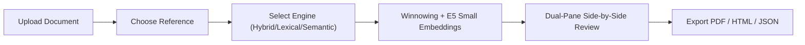

# Hybrid AI-Powered Multilingual Plagiarism Detection and Analysis System

> **Roadmap Status:** **Phase 7 Completed — All Phases (0–7) Implemented & Verified**  
> **Final Readiness:** **Level 1 (Localhost Demo Ready)** & **Level 2 (Local Release Ready)**  
> **Operating System:** Native Windows 11 Localhost (`http://localhost:5173`, `http://localhost:8000`)  
> **Framework:** Google Antigravity Engineering System  

---

## 1. Executive Summary & Product Vision

The **Hybrid AI-Powered Multilingual Plagiarism Detection and Analysis System** is an enterprise-grade document similarity and academic attribution platform. Inspired by the clean, frictionless utility design of **iLovePDF**, the platform enables students, researchers, educators, and institutions to verify document originality through a rigorous, two-stage hybrid pipeline:

1. **Deterministic Lexical Fingerprinting & Inverted Indexing:** Karp-Rabin rolling hashes ($k=25, w=16$) and Okapi BM25 for rapid exact and near-exact match retrieval with guaranteed detection bounds ($t=40$ tokens).
2. **Multilingual Dense Vector Embeddings:** Dense vector search (`intfloat/multilingual-e5-small`, 384 dimensions) for cross-lingual and paraphrased similarity across English, Hindi (हिन्दी), and Telugu (తెలుగు).
3. **Token-Level Verification & Explainability:** Smith-Waterman passage alignment, sentence-level attribution, citation and quotation exclusions, and human-in-the-loop review interfaces.
4. **Minimalist 5-Stage User Flow:** Progressive disclosure: **Upload $\to$ Compare $\to$ Analyze $\to$ Review $\to$ Download**.

### Core Ethical Principle
**Text similarity is not automatically plagiarism.** A shared citation, a standard technical definition, or an authorized translation is valid academic reuse. The system acts as an evidentiary analysis tool that visualizes overlapping spans, calculates distinct lexical vs. semantic coverage, and surfaces match uncertainty. It never generates automated disciplinary verdicts.

---

## 2. Capabilities & Supported Modalities

### Supported Document Formats
- **PDF Documents** (`.pdf`) via `pypdf` with page-aware extraction
- **Word Documents** (`.docx`) via `python-docx`
- **Plain Text** (`.txt`) with UTF-8 NFC Unicode normalization

### Multilingual Script Support
- **English** (High resource, verified baseline)
- **Hindi** (Modern Standard Hindi, Devanagari script with verified Unicode matras)
- **Telugu** (Telugu script, Dravidian morphology with verified Unicode ligatures)

### Three Comparison Modes
1. **Direct Comparison:** Fast one-to-one document comparison without pre-indexed corpora.
2. **One-to-Many Comparison:** One submitted document compared simultaneously against a custom batch of reference files.
3. **Corpus Search:** One submitted document queried against an access-controlled persistent collection.

---

## 3. Quick Local Startup (Single Command)

To launch the complete application on Windows 11 without Docker or external server setup:

```powershell
.\scripts\start-local.ps1
```

The script automatically verifies the Python virtual environment, Node dependencies, and port availability (8000 and 5173), starts both services, and prints the local URLs:

- **Web Application:** [http://localhost:5173](http://localhost:5173)
- **FastAPI Interactive Docs:** [http://localhost:8000/docs](http://localhost:8000/docs)
- **Health Check Endpoint:** [http://localhost:8000/health](http://localhost:8000/health)

Pressing `Enter` or `Ctrl+C` cleanly shuts down all background processes and releases the ports.

---

## 4. Complete Test Suites & Verification

### Running Automated Tests
```powershell
# 1. Run all backend tests (104 tests)
.\apps\backend\.venv\Scripts\python.exe -m pytest apps/backend/tests -q

# 2. Run frontend web tests (21 tests)
cd apps\web ; npm test -- --run ; cd ..

# 3. Verify TypeScript build (0 errors)
cd apps\web ; npm run build ; cd ..

# 4. Run Phase 6 regression suite (14 scenarios)
.\apps\backend\.venv\Scripts\python.exe scripts/verify_phase6_e2e.py

# 5. Run Phase 7 master acceptance suite (26 scenarios A through Z)
.\apps\backend\.venv\Scripts\python.exe scripts/verify_phase7_e2e.py

# 6. Verify SQLite hot backup & restore round-trip
.\apps\backend\.venv\Scripts\python.exe scripts/backup_restore.py --test
```

---

## 5. Architecture & Coexistence Model

The platform maintains two isolated execution tiers:
- **Tier 1 (Active Localhost):** Native Windows 11 execution using a SQLite development adapter (`WAL` mode), in-memory/BLOB vector store, and bounded Python `ThreadPoolExecutor`.
- **Tier 2 (Production Blueprint):** Preserved specifications and migrations for PostgreSQL 16 (`pgvector`), Redis 7 (`RQ` workers), S3 object storage, and Docker Compose.



---

## 6. Multi-Format Report Generation

- **Formal PDF Report:** ReportLab canvas layout with executive summary cards, source breakdown tables, finding cards, and native Indic font support (`Nirmala.ttc`).
- **Offline HTML Report:** Standalone single-file report with embedded CSS, zero external CDN scripts, and print optimization (`@media print`).
- **Structured JSON Audit:** Complete machine-readable audit trail conforming to Phase 0 schemas.

---

## 7. Known Scientific Limitations
- **Theoretical Winnowing Window:** Guarantees detection of exact matches of length $\ge 40$ tokens. Shorter common phrases are excluded by design to prevent false positives.
- **Cosine Similarity vs Misconduct:** High semantic similarity ($\ge 0.82$) indicates conceptual overlap; academic human review is required to verify legitimacy.
- **Scanned Documents:** Digitally generated PDFs with text streams are supported; non-OCR raster scans require external OCR preprocessing.

---

## 8. Eight-Phase Roadmap Completion

| Phase | Milestone Title | Scope & Status |
| :--- | :--- | :--- |
| **Phase 0** | **Requirements & Architecture** | Complete system specifications, contracts, and threat models. (**PASS**) |
| **Phase 1** | **Engineering Foundation** | FastAPI + React boilerplate, test framework, API models. (**PASS**) |
| **Phase 2** | **Document Ingestion** | PDF/DOCX/TXT text extraction, Unicode normalization, collections. (**PASS**) |
| **Phase 3** | **Lexical Engine** | Winnowing rolling hashes, BM25 retrieval, Smith-Waterman alignment. (**PASS**) |
| **Phase 4** | **Semantic AI** | Multilingual E5 Small embeddings, cross-language retrieval, hybrid scoring. (**PASS**) |
| **Phase 5** | **Scientific Evaluation** | Benchmark calibration, threshold tuning, false-positive taxonomy. (**PASS**) |
| **Phase 6** | **Minimalist UI & Reviews** | iLovePDF-inspired 5-stage workflow, dual-pane viewer, reviewer decisions. (**PASS**) |
| **Phase 7** | **System Hardening & Release** | Indic PDF fix, hot backup/restore, single-command runner, 26 E2E tests. (**PASS**) |
