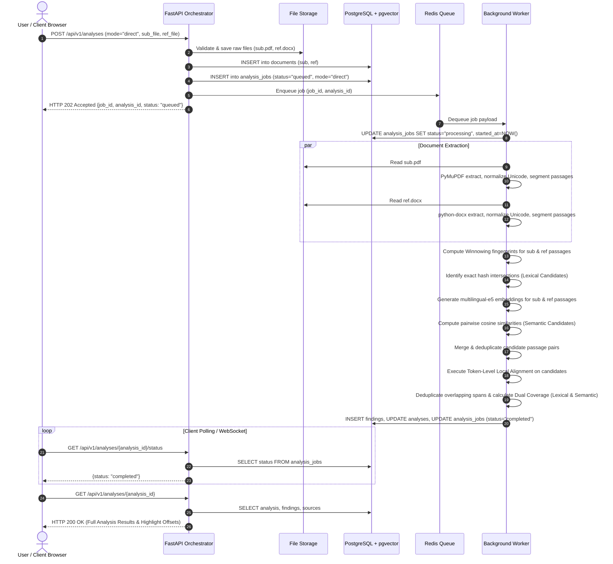
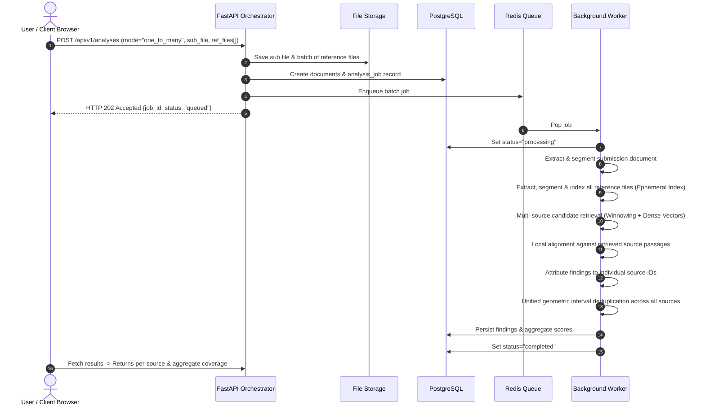
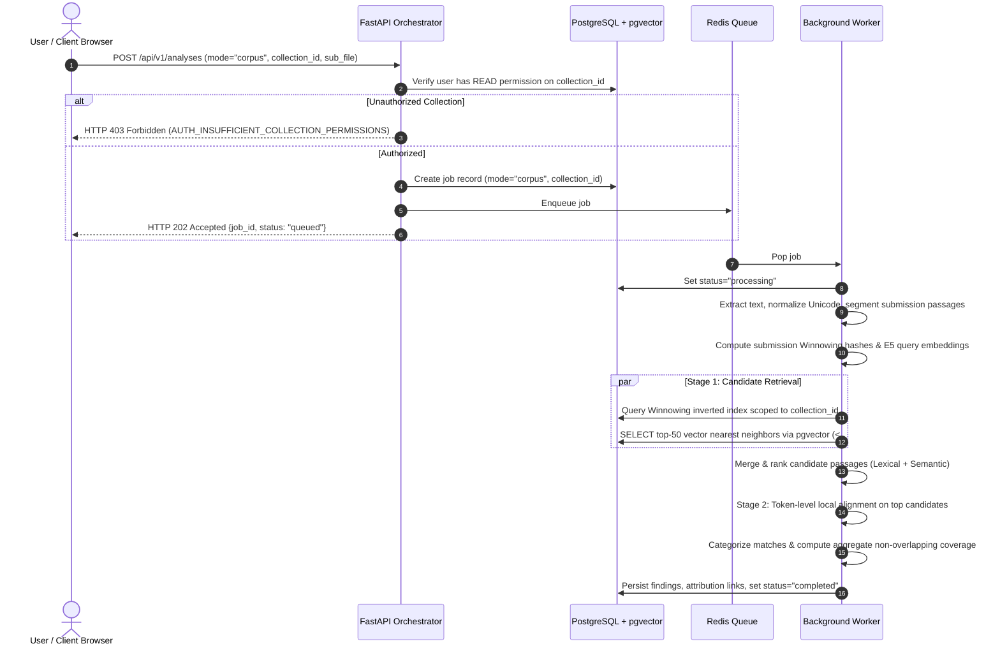
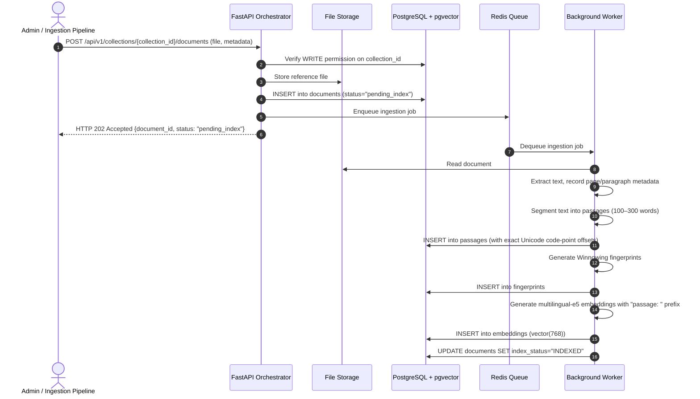
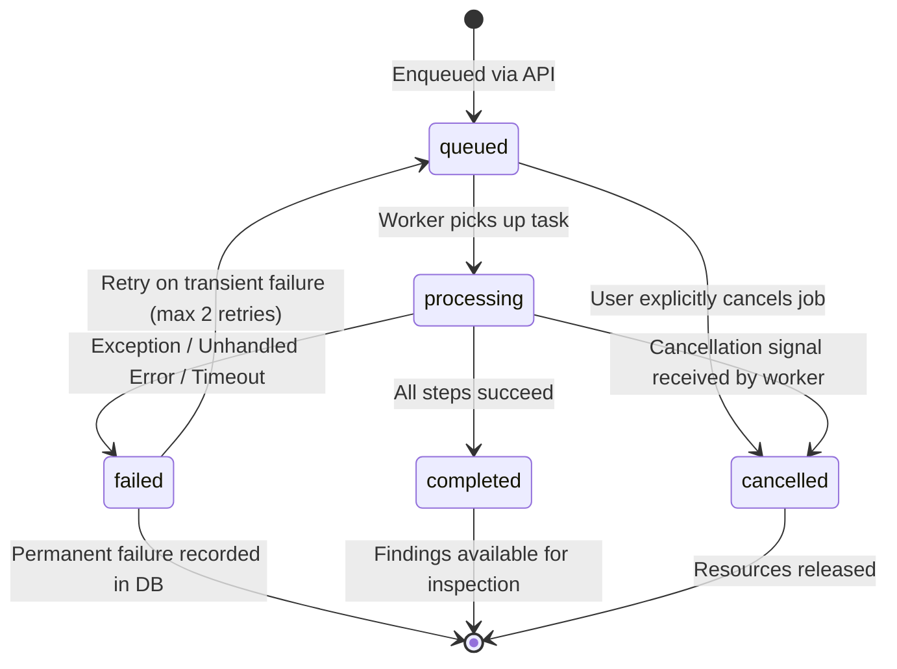
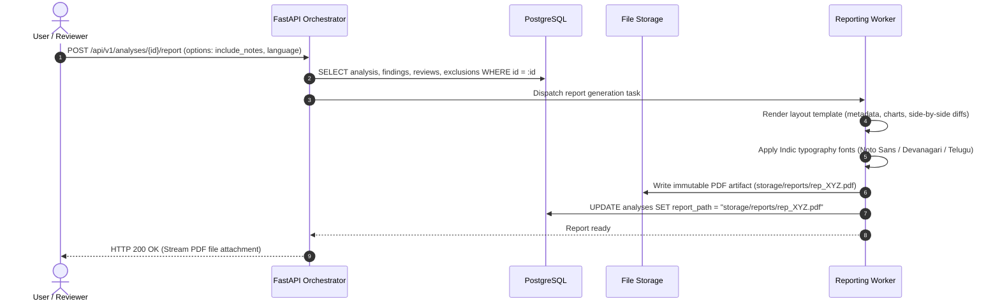
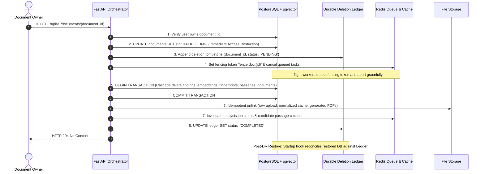

# Processing Workflows & Sequence Diagrams

> **Project:** Hybrid AI-Powered Multilingual Plagiarism Detection and Analysis System  
> **Phase:** Phase 0 — Blueprint & Architecture  
> **Date:** October 2026  

---

## 1. Overview

This document formalizes the execution sequences across all operational flows. Every diagram specifies interactions between the Client Browser, API Orchestrator, Redis Message Queue, Background Worker Pool, File Storage, and PostgreSQL/pgvector database.

---

## 2. Sequence 1: Mode A — Direct Document Comparison

Mode A performs real-time pairwise comparison between one submitted document and one reference document without requiring pre-indexed persistent collections.

---

## 3. Sequence 2: Mode B — One-to-Many Comparison

Mode B compares one submitted document against a user-supplied batch of up to 10 reference files simultaneously.

---

## 4. Sequence 3: Mode C — Indexed Corpus Search

Mode C queries an uploaded document against an authorized, pre-indexed persistent reference collection in PostgreSQL and `pgvector`.

---

## 5. Sequence 4: Reference Document Ingestion & Corpus Indexing

Authorized users or administrators add reference materials to a persistent collection.

---

## 6. Sequence 5: Background Job State Lifecycle & Resilience

---

## 7. Sequence 6: Analysis Report Generation (PDF Export)

---

## 8. Sequence 7: Reliable Multi-Tier Document Deletion Lifecycle

