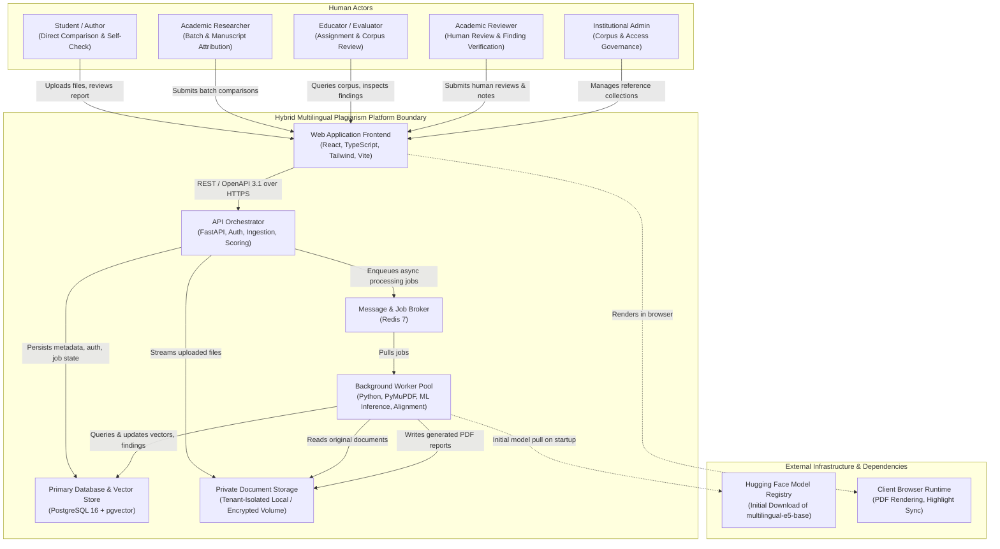

# System Context & Architecture Boundaries

> **Project:** Hybrid AI-Powered Multilingual Plagiarism Detection and Analysis System  
> **Phase:** Phase 0 — Blueprint & Architecture  
> **Date:** October 2026  

---

## 1. System Context Overview

The **Hybrid AI-Powered Multilingual Plagiarism Detection and Analysis System** operates as an autonomous, self-contained web platform designed for academic and research document originality analysis. The system provides clear separation between user interactions, application orchestration, background computation, and persistence layers.

---

## 2. System Context Diagram (C4 Level 1)

---

## 3. Actors & Personas

| Actor | Role & Boundary Responsibilities |
|---|---|
| **Student / Author** | Uploads individual drafts for Mode A or Mode B comparisons; receives immediate originality feedback; does not have administrative rights to alter institutional collections. |
| **Academic Researcher** | Performs multi-document comparisons (Mode B); reviews detailed lexical and semantic coverage scores; exports verified PDF dossiers. |
| **Educator / Evaluator** | Executes Mode C searches against institutional reference corpora; analyzes flagged student submissions; accesses human review tools. |
| **Academic Reviewer** | Verified subject-matter expert who inspects flagged passages, applies labels (`VALID_CITATION`, `SUSPECTED_PLAGIARISM`, etc.), and verifies context. |
| **Institutional Admin** | Manages departmental reference collections, controls user permissions, monitors storage quotas, and enforces document retention policies. |

---

## 4. External Dependencies & Operational Boundaries

1. **Model Hub (`intfloat/multilingual-e5-base`):** Pre-trained transformer weights are pulled from Hugging Face Hub during container build or initial setup and stored locally in a mounted cache volume. **No live internet access is required during runtime inference.**
2. **Client Browser Runtime:** The frontend executes inside modern standard browsers (Chrome, Firefox, Safari, Edge). It renders side-by-side textual diffs and converts Unicode code points to UTF-16 DOM character ranges for visual highlighting.
3. **Storage Subsystem:** Documents are stored in an encrypted, isolated directory structure outside the public web server root. In local deployments, this is a dedicated filesystem volume (`./storage`); in cloud environments, an S3-compatible bucket with strict tenant policies.
