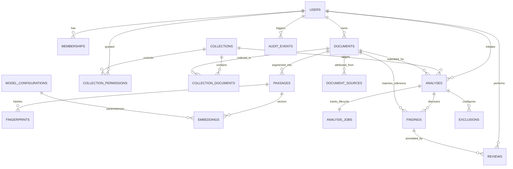

# Database Data Model & Entity Architecture

> **Project:** Hybrid AI-Powered Multilingual Plagiarism Detection and Analysis System  
> **Database Engine:** PostgreSQL 16+ with `pgvector` Extension  
> **Phase:** Phase 0 — Blueprint & Architecture  
> **Date:** October 2026  

---

## 1. Overview

The persistence architecture unifies relational domain metadata and high-dimensional vector embeddings within a single PostgreSQL database instance using `pgvector`. This guarantees ACID transactional integrity, avoids dual-database synchronization bugs, and enables SQL queries that combine relational permission filters with vector similarity operations.

---

## 2. Entity-Relationship Diagram (ERD)

---

## 3. Entity Catalog & Table Schemas

### 3.1 `users`
Represents registered user identities and service accounts.
- `id` (UUID, Primary Key, default `gen_random_uuid()`)
- `email` (VARCHAR(255), Unique, Not Null)
- `hashed_password` (VARCHAR(255), Not Null)
- `role` (VARCHAR(32), Not Null, e.g., `GUEST`, `STUDENT`, `RESEARCHER`, `EDUCATOR`, `REVIEWER`, `ADMIN`)
- `full_name` (VARCHAR(255))
- `institution_id` (UUID, Nullable)
- `created_at` (TIMESTAMPTZ, default `NOW()`)
- `updated_at` (TIMESTAMPTZ, default `NOW()`)

### 3.2 `collections`
Logical reference corpora of source materials for Mode C comparisons.
- `id` (UUID, Primary Key)
- `name` (VARCHAR(120), Not Null)
- `description` (TEXT)
- `owner_user_id` (UUID, References `users.id`, Not Null)
- `is_public_within_tenant` (BOOLEAN, default `FALSE`)
- `document_count` (INTEGER, default 0)
- `created_at` (TIMESTAMPTZ, default `NOW()`)

### 3.3 `collection_permissions`
Fine-grained access control mapping users to reference collections.
- `id` (UUID, Primary Key)
- `collection_id` (UUID, References `collections.id` ON DELETE CASCADE, Not Null)
- `user_id` (UUID, References `users.id` ON DELETE CASCADE, Not Null)
- `permission_level` (VARCHAR(16), Not Null, e.g., `READ`, `WRITE`, `ADMIN`)
- `granted_at` (TIMESTAMPTZ, default `NOW()`)
- **Constraint:** `UNIQUE(collection_id, user_id)`

### 3.4 `documents`
Uploaded files and extracted text representations.
- `id` (UUID, Primary Key)
- `owner_user_id` (UUID, References `users.id` ON DELETE CASCADE, Not Null)
- `filename` (VARCHAR(255), Not Null)
- `mime_type` (VARCHAR(128), Not Null)
- `sha256_hash` (CHAR(64), Not Null)
- `storage_path` (VARCHAR(512), Not Null)
- `file_size_bytes` (BIGINT, Not Null)
- `page_count` (INTEGER, default 1)
- `char_count` (INTEGER, default 0, length in Unicode code points)
- `raw_text` (TEXT, Not Null, canonical extracted text)
- `detected_language` (VARCHAR(8), Nullable)
- `created_at` (TIMESTAMPTZ, default `NOW()`)
- **Index:** `CREATE INDEX idx_documents_owner ON documents(owner_user_id);`
- **Index:** `CREATE INDEX idx_documents_sha256 ON documents(sha256_hash);`

### 3.5 `collection_documents`
Join table tracking which reference documents belong to which collections.
- `collection_id` (UUID, References `collections.id` ON DELETE CASCADE)
- `document_id` (UUID, References `documents.id` ON DELETE CASCADE)
- `indexed_at` (TIMESTAMPTZ, default `NOW()`)
- `status` (VARCHAR(32), default `INDEXED`)
- **Primary Key:** `(collection_id, document_id)`

### 3.6 `document_sources`
Metadata provenance, licensing, and author information for reference documents.
- `id` (UUID, Primary Key)
- `document_id` (UUID, References `documents.id` ON DELETE CASCADE, Unique, Not Null)
- `title` (VARCHAR(255), Not Null)
- `author` (VARCHAR(255))
- `publication_year` (INTEGER)
- `license` (VARCHAR(64), default `CC-BY-4.0`)
- `provenance_uri` (VARCHAR(1024))

### 3.7 `passages`
Contextual textual chunks extracted from documents (100–300 words).
- `id` (UUID, Primary Key)
- `document_id` (UUID, References `documents.id` ON DELETE CASCADE, Not Null)
- `sequence_index` (INTEGER, Not Null)
- `start_offset` (INTEGER, Not Null, canonical zero-based Unicode code point)
- `end_offset` (INTEGER, Not Null, canonical zero-based Unicode code point)
- `text_content` (TEXT, Not Null)
- `token_count` (INTEGER, Not Null)
- `page_number` (INTEGER, default 1)
- `language` (VARCHAR(8), default `en`)
- **Index:** `CREATE INDEX idx_passages_doc ON passages(document_id, sequence_index);`
- **Constraint:** `CHECK (end_offset > start_offset)`

### 3.8 `fingerprints`
Winnowing rolling-hash values for exact verbatim matching.
- `id` (BIGSERIAL, Primary Key)
- `hash_value` (BIGINT, Not Null)
- `passage_id` (UUID, References `passages.id` ON DELETE CASCADE, Not Null)
- `document_id` (UUID, References `documents.id` ON DELETE CASCADE, Not Null)
- `start_offset` (INTEGER, Not Null)
- `end_offset` (INTEGER, Not Null)
- **Index:** `CREATE INDEX idx_fingerprints_hash ON fingerprints(hash_value);`
- **Index:** `CREATE INDEX idx_fingerprints_doc ON fingerprints(document_id);`

### 3.9 `model_configurations`
Registered embedding and reranker model versions.
- `id` (VARCHAR(64), Primary Key, e.g., `multilingual-e5-base-v1`)
- `model_identifier` (VARCHAR(128), Not Null, e.g., `intfloat/multilingual-e5-base`)
- `model_revision` (VARCHAR(64), Not Null, Git commit SHA)
- `dimensions` (INTEGER, default 768)
- `is_active` (BOOLEAN, default TRUE)
- `created_at` (TIMESTAMPTZ, default `NOW()`)

### 3.10 `embeddings`
768-dimensional dense vector representations stored via `pgvector`.
- `id` (UUID, Primary Key)
- `passage_id` (UUID, References `passages.id` ON DELETE CASCADE, Unique, Not Null)
- `document_id` (UUID, References `documents.id` ON DELETE CASCADE, Not Null)
- `model_config_id` (VARCHAR(64), References `model_configurations.id`, Not Null)
- `embedding` (vector(768), Not Null)
- `created_at` (TIMESTAMPTZ, default `NOW()`)
- **Index (Conditional HNSW in Phase 5/7):** `CREATE INDEX idx_embeddings_hnsw ON embeddings USING hnsw (embedding vector_ip_ops) WITH (m = 16, ef_construction = 64);`

### 3.11 `analyses`
Container record for an executed comparison run.
- `id` (UUID, Primary Key)
- `user_id` (UUID, References `users.id` ON DELETE CASCADE, Not Null)
- `submission_document_id` (UUID, References `documents.id` ON DELETE CASCADE, Not Null)
- `mode` (VARCHAR(16), Not Null, `direct` | `one_to_many` | `corpus`)
- `target_collection_id` (UUID, References `collections.id`, Nullable)
- `eligible_code_points` (INTEGER, default 0)
- `overall_lexical_coverage_percent` (NUMERIC(5,2), default 0.00)
- `overall_semantic_coverage_percent` (NUMERIC(5,2), default 0.00)
- `net_adjusted_score_percent` (NUMERIC(5,2), default 0.00)
- `report_path` (VARCHAR(512), Nullable)
- `created_at` (TIMESTAMPTZ, default `NOW()`)
- `completed_at` (TIMESTAMPTZ, Nullable)

### 3.12 `analysis_jobs`
Lifecycle state tracker for background worker execution.
- `id` (UUID, Primary Key)
- `analysis_id` (UUID, References `analyses.id` ON DELETE CASCADE, Unique, Not Null)
- `status` (VARCHAR(16), Not Null, `queued` | `processing` | `completed` | `failed` | `cancelled`)
- `progress_percent` (INTEGER, default 0)
- `current_step` (VARCHAR(64))
- `error_code` (VARCHAR(64), Nullable)
- `error_message` (TEXT, Nullable)
- `started_at` (TIMESTAMPTZ, Nullable)
- `completed_at` (TIMESTAMPTZ, Nullable)

### 3.13 `findings`
Verified match instances discovered between submission and reference passages.
- `id` (UUID, Primary Key)
- `analysis_id` (UUID, References `analyses.id` ON DELETE CASCADE, Not Null)
- `submission_document_id` (UUID, References `documents.id` ON DELETE CASCADE, Not Null)
- `reference_document_id` (UUID, References `documents.id` ON DELETE CASCADE, Not Null)
- `category` (VARCHAR(32), Not Null, `exact_copy` | `near_exact_rewrite` | `paraphrase` | `potential_translation`)
- `confidence` (VARCHAR(16), Not Null, `high` | `moderate` | `low`)
- `submission_start_offset` (INTEGER, Not Null)
- `submission_end_offset` (INTEGER, Not Null)
- `submission_excerpt` (TEXT, Not Null)
- `reference_start_offset` (INTEGER, Not Null)
- `reference_end_offset` (INTEGER, Not Null)
- `reference_excerpt` (TEXT, Not Null)
- `reference_page_number` (INTEGER, default 1)
- `lexical_similarity` (NUMERIC(5,4), default 0.0000)
- `semantic_similarity` (NUMERIC(5,4), default 0.0000)
- `is_quoted` (BOOLEAN, default FALSE)
- `is_in_bibliography` (BOOLEAN, default FALSE)
- `is_excluded` (BOOLEAN, default FALSE)
- **Index:** `CREATE INDEX idx_findings_analysis ON findings(analysis_id);`

### 3.14 `exclusions`
Rules configured to ignore specific spans (citations, bibliography, headers).
- `id` (UUID, Primary Key)
- `analysis_id` (UUID, References `analyses.id` ON DELETE CASCADE, Not Null)
- `rule_type` (VARCHAR(32), Not Null, `QUOTATION`, `BIBLIOGRAPHY`, `MANUAL`)
- `start_offset` (INTEGER, Not Null)
- `end_offset` (INTEGER, Not Null)
- `reason` (VARCHAR(255))

### 3.15 `reviews`
Human reviewer decisions applied to flagged findings.
- `id` (UUID, Primary Key)
- `finding_id` (UUID, References `findings.id` ON DELETE CASCADE, Not Null)
- `reviewer_user_id` (UUID, References `users.id`, Not Null)
- `review_label` (VARCHAR(32), Not Null, `VALID_CITATION` | `SUSPECTED_PLAGIARISM` | `FALSE_POSITIVE` | `IGNORED`)
- `notes` (TEXT)
- `created_at` (TIMESTAMPTZ, default `NOW()`)

### 3.16 `audit_events`
Immutable security and compliance log.
- `id` (BIGSERIAL, Primary Key)
- `user_id` (UUID, Nullable)
- `event_type` (VARCHAR(64), Not Null)
- `resource_type` (VARCHAR(64), Not Null)
- `resource_id` (VARCHAR(64), Not Null)
- `ip_address` (VARCHAR(45))
- `timestamp` (TIMESTAMPTZ, default `NOW()`)
- `details` (JSONB)
