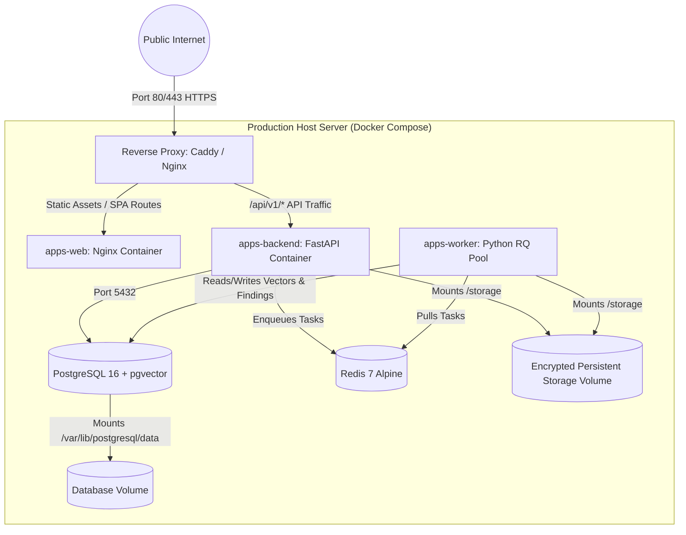

# Deployment Architecture & Operations Runbook

> **Project:** Hybrid AI-Powered Multilingual Plagiarism Detection and Analysis System  
> **Phase:** Phase 0 — Blueprint & Architecture  
> **Target Execution Phase:** Phase 1 (Foundation) & Phase 7 (Hardening & Deploy)  
> **Date:** October 2026  

---

## 1. Deployment Philosophy & Topologies

The production deployment strategy prioritizes a **Practical Single-Server Containerized Architecture** using Docker Compose. This minimizes operational complexity, enables rapid institutional on-premises deployment, and eliminates distributed networking overhead while maintaining clean container boundaries.

### Environments Matrix
- **Development (Local):** Docker Compose running PostgreSQL, Redis, with frontend and FastAPI backend hot-reloading on the host.
- **Testing (CI Runner):** Ephemeral headless Docker Compose executing automated pytest and Playwright suites.
- **Staging / Production (Single Host):** Complete multi-container Docker Compose deployment managed by systemd or Docker daemon with automated HTTPS via Caddy reverse proxy.
- **Future Scale-Out (Phase 7+):** Separate worker nodes scaling horizontally against a managed PostgreSQL instance and Redis cluster.

---

## 2. Production Container Orchestration (`compose.yml` Architecture)

The permanent production deployment encapsulates five dedicated services:



### Container Specifications
1. **`proxy` (Caddy / Nginx):** Handles TLS termination, Let's Encrypt automated certificate renewals, gzip/brotli compression, and reverse proxies requests.
2. **`web` (React SPA):** Multi-stage Docker build; compiles Vite TypeScript into static assets served via high-performance Nginx.
3. **`backend` (FastAPI API Server):** Python 3.11 image running Uvicorn ASGI server with Gunicorn process manager (`4` worker processes).
4. **`worker` (Background Worker Pool):** Python 3.11 image executing Python RQ daemons with PyTorch and PyMuPDF libraries.
5. **`db` (PostgreSQL 16 with pgvector):** Official `pgvector/pgvector:pg16` image.
6. **`redis` (Cache & Message Broker):** Official `redis:7-alpine` image with append-only persistence enabled.

---

## 3. Database Migration & Initialization Strategy

- **Tooling:** Alembic asynchronously configured in `apps/backend/alembic/`.
- **Deployment Lifecycle Hook:** The API container entrypoint executes pending migrations automatically before starting Uvicorn:
  ```bash
  alembic upgrade head
  ```
- **Zero-Downtime Rule:** All migrations must be backwards-compatible (expand before contract). Column drops or table renames must occur across two separate releases.

---

## 4. Backup & Disaster Recovery Procedures

### 4.1 Daily Automated Backup
An automated host cron job executes nightly at 02:00 UTC:
```bash
docker compose exec -T db pg_dump -U postgres -d plagiarism_platform -Fc > /backups/db_$(date +%Y%m%d_%H%M%S).dump
rsync -avz /storage/uploads /backups/uploads_snapshot/
```
Backups are encrypted using AES-256 and retained for 30 days.

### 4.2 Disaster Restoration Procedure
1. Stop running API and worker containers: `docker compose stop backend worker`
2. Restore database snapshot:
   ```bash
   docker compose exec -T db pg_restore -U postgres -d plagiarism_platform -c /backups/db_snapshot.dump
   ```
3. Replay hard deletion reconciliation:
   ```bash
   python -m plagiarism.jobs.reconcile_deletions
   ```
4. Restart application containers: `docker compose start backend worker`
5. Verify health probes: `curl http://localhost:8000/api/v1/health`

---

## 5. Rollback & Health Check Runbook

### Health Probes
- **Liveness Probe:** `GET /api/v1/health` asserts API server is responding (HTTP 200).
- **Readiness Probe:** Asserts PostgreSQL connection pool is active and Redis ping succeeds (`{"status": "healthy", "database": "connected", "redis": "connected"}`).

### Rollback Procedure
If a deployment fails health checks:
1. Re-tag container image to prior release tag: `IMAGE_TAG=v1.0.2 docker compose up -d`
2. If database migration was applied: execute `alembic downgrade -1`
3. Verify readiness probe returns HTTP 200.
