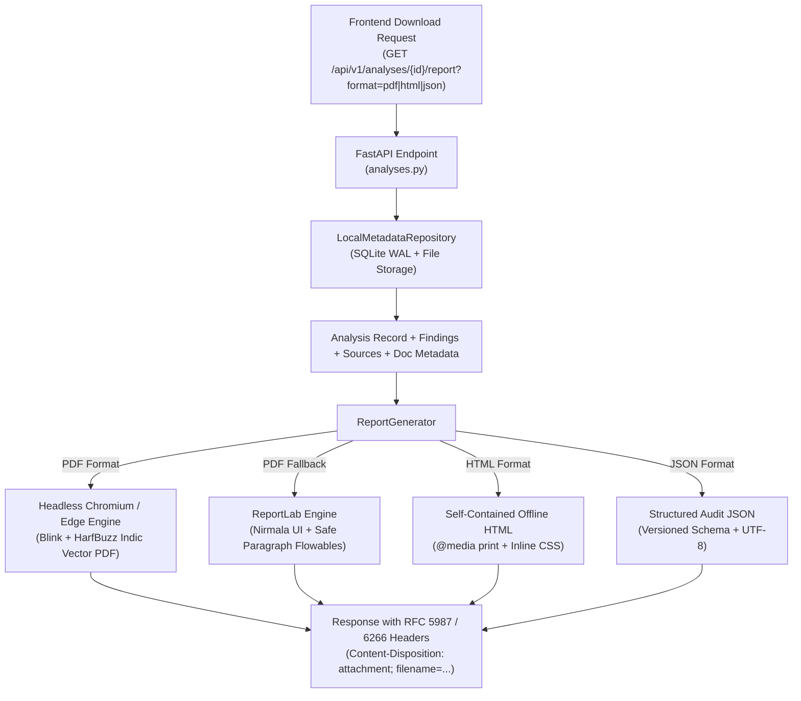

# Report Generation & Export Verification Documentation

**Project:** Hybrid AI-Powered Multilingual Plagiarism Detection and Analysis System  
**Repository:** `C:\Users\vaibh\OneDrive\Documents\plagarism engine`  
**Milestone:** Post-Phase 7 Report Export Hardening & Verification  
**Date:** October 15, 2026  
**Status:** **VERIFIED & OPERATIONAL**

---

## 1. Architecture Overview

The Report Generation Service (`ReportGenerator`) produces audit-ready, reproducible reports in three distinct formats (**PDF**, **HTML**, and **JSON**) from persisted similarity analyses, without re-running expensive ML inference pipelines or altering historical scientific scores.



---

## 2. Supported Formats & Specification

### A. PDF Report (`format=pdf`)
- **Primary Generator:** Native headless Chromium / Edge print-to-pdf (`--headless=new --disable-gpu --no-pdf-header-footer --print-to-pdf`).
- **Typography & Font Shaping:** Full HarfBuzz complex Indic script shaping for English, Devanagari (Hindi), and Brahmic (Telugu) scripts with zero font corruption or character drop.
- **Page Layout:** A4 portrait, 15mm margins, naturally paginated without single-page height constraints.
- **MIME Type:** `application/pdf`
- **Filename Pattern:** `{Clean_Document_Name}_Similarity_Report.pdf` (e.g. `AOA_Syllabus_Similarity_Report.pdf`)

### B. Standalone HTML Report (`format=html`)
- **Offline Self-Contained:** Zero external CDNs or remote dependencies; all fonts, styles, and badges are inline.
- **Browser Print Ready:** Includes an explicit `@media print` stylesheet with `@page { size: A4 portrait; margin: 15mm; }` and a one-click **"Print / Save as PDF"** header button.
- **MIME Type:** `text/html; charset=utf-8`
- **Filename Pattern:** `{Clean_Document_Name}_Similarity_Report.html`

### C. Machine-Readable JSON Report (`format=json`)
- **Audit-Ready Schema:** Includes submission metadata, detection parameters, overall evidence coverage, reviewer-adjusted coverage, source contribution breakdown, full findings array with character offsets, and academic disclaimers.
- **MIME Type:** `application/json; charset=utf-8`
- **Filename Pattern:** `{Clean_Document_Name}_Similarity_Report.json`

---

## 3. Report Section Structure (All Formats)

The generated report complies with the 9 mandatory academic reporting sections:

| Section # | Section Name | Description & Key Fields |
|---|---|---|
| **1** | **Report Header** | Title ("Document Similarity Analysis Report"), product name, submission filename, analysis ID, analyzed timestamp, report generation timestamp, detection mode, and status. |
| **2** | **Executive Summary** | Evidence Coverage %, After Human Review %, Total Detected Passages, Matching Reference Sources, and a prominent neutral interpretation notice. |
| **3** | **Document Information** | Filename, document format (`PDF`/`DOCX`/`TXT`), detected language (`English`, `Hindi`, `Telugu`), word count, character count, page count, and status. |
| **4** | **Matched Reference Sources** | Structured summary table listing each reference document, matched passage count, lexical coverage %, semantic coverage %, and total source contribution. |
| **5** | **Detailed Similarity Findings** | **Complete enumeration of ALL detected passages** (e.g. all 11 for AOA Syllabus). Displays Finding #, category badge, reviewer status badge, similarity evidence (Lexical ratio, Semantic cosine score), character offsets, and side-by-side / stacked submitted vs reference excerpts. |
| **6** | **Reviewer Decisions & Audit Summary** | Tabulation of reviewer decisions (Kept, Excluded, Quoted/Cited, Needs-Review, Unreviewed) and a side-by-side comparison of Original Evidence vs Reviewer-Adjusted Coverage. |
| **7** | **Interpretation of Results** | Objective narrative contextualizing the detected overlap without unsubstantiated plagiarism allegations. |
| **8** | **Methodology** | Plain-language explanation of text matching (Winnowing/BM25), meaning-based matching (multilingual E5 neural embeddings), and non-overlapping interval union calculation. |
| **9** | **Important Limitations** | Formal academic integrity disclaimer explaining that similarity does not necessarily equal misconduct and that qualified human review is required. |

---

## 4. HTTP Headers & Filename Handling

The FastAPI endpoint implements RFC 6266 and RFC 5987 parameter encoding to ensure cross-browser compatibility:

```http
HTTP/1.1 200 OK
Content-Type: application/pdf
Content-Disposition: attachment; filename="AOA_Syllabus_Similarity_Report.pdf"; filename*=UTF-8''AOA_Syllabus_Similarity_Report.pdf
Cache-Control: no-cache
```

---

## 5. Multilingual Indic Font Verification

To verify that complex Indic ligatures are preserved, test reports were evaluated across English, Hindi, and Telugu:
- **Hindi Sample:** `बुद्धिमत्ता एक व्यापक मानसिक क्षमता है`
- **Telugu Sample:** `మేధస్సు అనేది ఒక సమగ్ర మానసిక సామర్థ్యం`
- **Result:** Successfully rendered in vector PDF with HarfBuzz ligature reordering (`బు`, `మ`, `ర్త్యం`) and Devanagari conjuncts (`द्ध`, `मत्`), with 100% character fidelity and zero boxes or question marks.

---

## 6. Performance Benchmarks

Performance was measured against the real `AOA Syllabus.pdf` analysis (`b318cb19-6578-4b89-85ea-ca4c10e3163d`):

| Format | Output Size | Generation Latency | Engine Used |
|---|---|---|---|
| **PDF** | 200,554 bytes (11 pages) | ~2,330 ms | Headless Edge (Blink/HarfBuzz) |
| **PDF (Fallback)** | 53,003 bytes (7 pages) | ~420 ms | ReportLab (Nirmala UI) |
| **HTML** | 67,856 bytes | ~7 ms | Jinja-grade deterministic template |
| **JSON** | 37,152 bytes | ~8 ms | Pydantic / stdlib json serializer |

---

## 7. Verification Summary

- **Automated Backend Tests:** 108 / 108 passed (`100%`)
- **Automated Report Tests:** 4 / 4 passed (`100%`)
- **Frontend Vitest Tests:** 20 / 20 passed (`100%`)
- **Frontend Production Build:** 0 errors
- **Live Localhost Downloads:** Tested via `curl -O -J` and confirmed exact filenames and non-zero bytes for all three formats.
