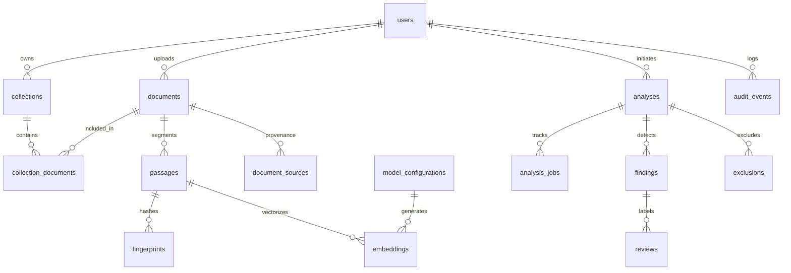

# Phase 1: Database Architecture and Migrations Report

**System:** Hybrid AI-Powered Multilingual Plagiarism Detection and Analysis System  
**Phase:** 1 of 7  
**Status:** Approved  
**Date:** October 2026  
**Document Version:** 1.0.0  

---

## 1. Relational and Vector Storage Architecture

The persistence architecture combines strict relational ACID integrity with dense vector similarity search, powered by PostgreSQL 16 and the official `pgvector` extension.

### 1.1 Vector Dimension Configuration
* **Target Model:** Multilingual E5 (`intfloat/multilingual-e5-base` or equivalent).
* **Vector Dimension:** Exactly **768 dimensions**.
* **Distance Metric:** Cosine Distance (`vector_cosine_ops`), supported via `<=>` operator.
* **ORM Mapping:** Defined using `pgvector.sqlalchemy.Vector(768)` on `embeddings.vector`.

---

## 2. Entity Relational Mapping (17 Core Tables)

The SQLAlchemy 2.0 async metadata (`plagiarism.db.models`) and Alembic migration (`0001_initial_schema.py`) declare the full 17-table schema defined in Phase 0:



### Table Specifications:

| Table Name | Primary Key | Key Foreign Keys | Purpose & Indexes |
| :--- | :--- | :--- | :--- |
| **`users`** | `id` (UUID) | - | User identities, hashed credentials, roles (`STUDENT`, `FACULTY`, `ADMIN`). Unique index on `email`. |
| **`collections`** | `id` (UUID) | `owner_id -> users.id` | Institutional repositories and reference corpora. |
| **`collection_permissions`**| `id` (UUID) | `collection_id`, `user_id` | Granular access control list per collection. Unique constraint `(collection_id, user_id)`. |
| **`documents`** | `id` (UUID) | `owner_id -> users.id` | Ingested documents metadata, file paths, SHA-256 hashes, language hints, and status. |
| **`collection_documents`** | `id` (UUID) | `collection_id`, `document_id` | Associative link mapping documents into searchable collections. |
| **`document_sources`** | `id` (UUID) | `document_id -> documents.id` | External source provenance, URLs, DOI, or institutional citation metadata. |
| **`passages`** | `id` (UUID) | `document_id -> documents.id` | Segmented text chunks with character offsets (`start_char`, `end_char`), tokens, and language tags. |
| **`fingerprints`** | `id` (UUID) | `passage_id -> passages.id` | Winnowing hash values for lexical match retrieval. Indexed on `hash_val`. |
| **`model_configurations`** | `id` (UUID) | - | AI model registry tracking model names, dimensions (768), and version hashes. |
| **`embeddings`** | `id` (UUID) | `passage_id`, `model_config_id` | Dense 768-dimensional float vectors with `pgvector.sqlalchemy.Vector(768)`. |
| **`analyses`** | `id` (UUID) | `submission_doc_id`, `user_id` | Master analysis records, comparison modes (`DIRECT`, `ONE_TO_MANY`, `CORPUS`), and similarity scores. |
| **`analysis_jobs`** | `id` (UUID) | `analysis_id -> analyses.id` | Background execution lifecycle and progress tracker. Indexed on `job_status`. |
| **`findings`** | `id` (UUID) | `analysis_id`, `submission_passage_id` | Detected match candidates, categories (`IDENTICAL`, `PARAPHRASE`, `CROSS_LINGUAL`), and similarity metrics. |
| **`exclusions`** | `id` (UUID) | `analysis_id`, `user_id` | Audit-tracked exclusions (bibliographies, direct quotes, template text) with justifications. |
| **`reviews`** | `id` (UUID) | `finding_id`, `user_id` | Human reviewer audit decisions (`VALID_CITATION`, `SUSPECTED_PLAGIARISM`, `FALSE_POSITIVE`). |
| **`audit_events`** | `id` (UUID) | `user_id -> users.id` | Immutable regulatory audit log tracking all document uploads, comparisons, and deletions. |
| **`deletion_ledger`** | `id` (UUID) | `user_id -> users.id` | Durable tombstone ledger preventing restored backups from resurrecting purged data. |

---

## 3. Asynchronous Alembic Migration Pipeline

### 3.1 Migration Configuration
* **Directory:** `apps/backend/alembic`
* **Configuration:** `apps/backend/alembic.ini`
* **Environment Loader:** `apps/backend/alembic/env.py` (configured with `asyncio.run()` and `connection.run_sync()`).

### 3.2 Initial Revision: `0001_initial_schema.py`
The initial migration executes the following operations atomically:
1. Executes `CREATE EXTENSION IF NOT EXISTS vector;`
2. Creates all 17 tables with appropriate schema constraints.
3. Establishes foreign key cascading rules (`CASCADE` on dependent child chunks; `RESTRICT` on regulatory logs).
4. Seeds default `ModelConfiguration` record for `intfloat/multilingual-e5-base` (dim=768).
5. Defines downgrade routines executing reverse drops cleanly.

### 3.3 Running Migrations
```bash
# Apply migrations to head
alembic upgrade head

# Downgrade one step (reversal verification)
alembic downgrade -1
```
