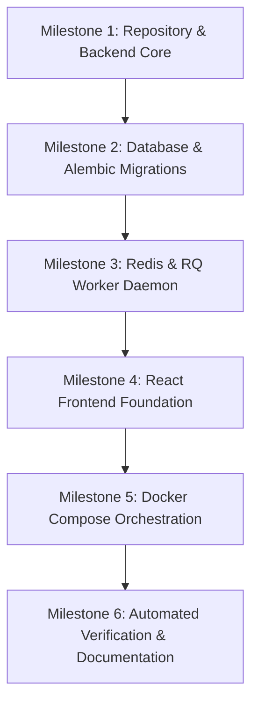

# Phase 1: Implementation Plan — Engineering Foundation & Infrastructure

**System:** Hybrid AI-Powered Multilingual Plagiarism Detection and Analysis System  
**Phase:** 1 of 7  
**Status:** Approved & Implemented  
**Date:** October 2026  
**Document Version:** 1.0.0  

---

## 1. Executive Objective

Phase 1 establishes a production-grade, locally deployable, and fully containerized engineering foundation for the Hybrid AI-Powered Multilingual Plagiarism Detection System. It bridges the finalized architecture, data dictionary, ADRs, and OpenAPI 3.1 contracts established in Phase 0 into real, runnable software while strictly observing development boundaries.

---

## 2. Scope Boundaries & Anti-Scope

### 2.1 In Scope (Phase 1 Deliverables)
1. **Repository Layout:** Clean monorepo structure with `apps/backend`, `apps/web`, `infra/`, `contracts/`, and `docs/`.
2. **Backend Engine:** Production-grade FastAPI async application with lifespan management, CORS, structured JSON logging, and `X-Request-ID` correlation middleware.
3. **Database Architecture:** PostgreSQL 16 schema with `pgvector` extension enabled, async SQLAlchemy 2.0 models for all 17 Phase 0 entities, and Alembic migration scripts.
4. **Asynchronous Job Worker:** Redis 7.2 broker integration with Python RQ worker runner, queue abstractions, and deterministic verification probe tasks.
5. **Contract Conformance:** Implementation of `/health` (`operationId: getHealthStatus`) matching `contracts/openapi.yaml`, and RFC 7807 `ErrorEnvelope` problem responses.
6. **Frontend Foundation:** React 18 + Vite + TypeScript SPA with Tailwind CSS, live health dashboard, and disabled shell navigation for future phases.
7. **Container Orchestration:** Multi-service `compose.yml` with named volumes protecting against OneDrive synchronization locks.
8. **CI/CD Pipeline:** GitHub Actions workflow executing contract checks, backend tests, migration verification, and frontend builds.
9. **Automated Tests:** Comprehensive unit test suites for backend settings, health, security, models, worker, and frontend components.

### 2.2 Strict Out-of-Scope (Phase 2+ Deferred Features)
* **No Text Extraction:** No PDF, DOCX, or OCR parsing (scheduled for Phase 2).
* **No Winnowing Fingerprinting:** No character k-gram hashing or fingerprint generation (scheduled for Phase 3).
* **No Embedding Downloads or Vector Inference:** No Multilingual E5 weights or inference routines (scheduled for Phase 3).
* **No Similarity Scoring:** No cosine ranking, Jaccard calculation, or match aggregation (scheduled for Phase 3).
* **No Synthetic Plagiarism Results:** UI components must not return mocked plagiarism percentages or fake document comparisons.

---

## 3. Component Architecture & Technology Choices

| Layer | Technology | Rationale & Specifications |
| :--- | :--- | :--- |
| **API Framework** | FastAPI 0.115+ (Python 3.11+) | Asynchronous ASGI framework with native OpenAPI 3.1 schema derivation, dependency injection, and Pydantic v2 validation. |
| **ORM & Migrations** | SQLAlchemy 2.0 (asyncio) + Alembic | Strongly typed async query engine using `asyncpg` driver; reversible schema versioning. |
| **Relational & Vector Store** | PostgreSQL 16 + pgvector | ACID relational integrity combined with native vector similarity searching (`vector(768)`). |
| **Task Queue & Broker** | Redis 7.2 + Python RQ | In-memory message broker with explicit task queues (`default`, `high`, `low`) for long-running workloads. |
| **Frontend Framework** | React 18 + TypeScript + Vite | High-performance SPA with strict typing, bundled with Vite and styled with utility-first Tailwind CSS. |
| **Web Server / Reverse Proxy**| Nginx Alpine | Serves production React build, gzip compression, and reverse-proxies `/api` traffic to FastAPI. |
| **Containerization** | Docker & Docker Compose v2 | Multi-stage slim container builds with unprivileged user execution (`appuser:1000`). |

---

## 4. Work Breakdown & Milestones

1. **Milestone 1: Backend Core:** Configuration management, RFC 7807 error envelopes, JWT RBAC security, and structured logging.
2. **Milestone 2: Database Schema:** SQLAlchemy ORM definitions for all 17 tables, `pgvector` vector(768) integration, and migration script.
3. **Milestone 3: Worker Queue:** Redis connection manager, RQ queue wrappers, and deterministic task probes (`ping_job`, `simulate_calculation`).
4. **Milestone 4: Web Application:** Contract-derived TypeScript interfaces, typed API client, live health dashboard, and phase boundary modal dialogs.
5. **Milestone 5: Container Infrastructure:** Multi-stage Dockerfiles (`backend`, `worker`, `web`), root `compose.yml`, and named persistent volumes.
6. **Milestone 6: Verification & CI:** Test suites, PowerShell runners, GitHub Actions CI workflow, and Phase 1 documentation bundle.
