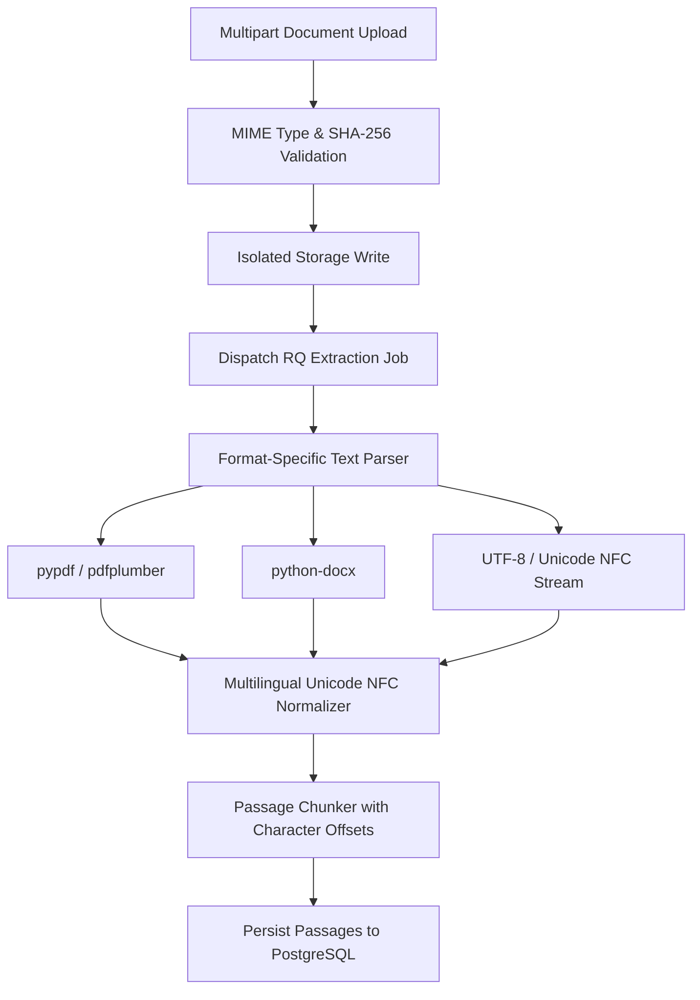

# Phase 1 to Phase 2 Technical Handoff Specification

**System:** Hybrid AI-Powered Multilingual Plagiarism Detection and Analysis System  
**From:** Phase 1 (Engineering Foundation and Infrastructure)  
**To:** Phase 2 (Document Ingestion and Multi-Format Text Extraction)  
**Date:** October 2026  
**Document Version:** 1.0.0  

---

## 1. Readiness State for Phase 2

Phase 1 provides a fully operational, test-verified full-stack foundation ready to accept real document ingestion and parsing workloads in Phase 2.

### 1.1 Verified Foundations Transferred:
1. **Database Models & Tables:**
   * `Document` (`documents` table) with status enums (`QUEUED`, `EXTRACTING`, `INDEXING`, `FAILED`).
   * `Passage` (`passages` table) with character offsets (`start_char`, `end_char`), token counts, and language fields.
   * `DocumentSource` (`document_sources` table) for source tracking and external citations.
2. **Asynchronous Processing Pipeline:**
   * Redis 7.2 broker running with queues: `high`, `default`, `low`.
   * Python RQ worker runner ready to execute long-running text extraction jobs without blocking web workers.
3. **Storage Subsystem:**
   * Storage root `/app/storage` (or `./storage` locally) configured with subdirectories `/app/storage/uploads` and `/app/storage/reports`.
   * Isolated via named Docker volume `plagiarism_storage_volume`.
4. **API Contracts:**
   * `POST /api/v1/documents` contract declared in `contracts/openapi.yaml` with multipart file upload support (PDF, DOCX, TXT, max 30 MB) and language hints (`en`, `hi`, `te`, `auto`).
5. **Frontend UI Shell:**
   * React frontend ready to mount file upload components, progress indicators, and document viewer panes.

---

## 2. Phase 2 Scope & Objectives

In Phase 2, the team will implement the complete Document Ingestion and Multi-Format Text Extraction pipeline:

### Key Phase 2 Deliverables:
1. **Format Parsers:**
   * PDF text extraction (`pypdf` / `pdfplumber`) preserving line breaks and page boundaries.
   * DOCX text extraction (`python-docx`) extracting headings, paragraphs, and tables.
   * Plain text extraction with strict UTF-8 decoding and charset detection (`chardet` / `charset-normalizer`).
2. **Multilingual Unicode Normalization:**
   * Unicode NFC normalization for English, Hindi (Devanagari), and Telugu scripts.
   * Whitespace and punctuation normalization without loss of semantic character offsets.
3. **Sliding Window Passage Segmentation:**
   * Segment documents into overlapping passages with exact `start_char` and `end_char` offsets relative to normalized text.
   * Tokenization with sentence boundaries.
4. **Endpoint Implementation:**
   * `POST /api/v1/documents` (upload handler).
   * `GET /api/v1/documents/{document_id}` (status & passage inspection).
   * `GET /api/v1/documents` (paginated document listing).
5. **Frontend Ingestion UI:**
   * Drag-and-drop file upload zone.
   * Real-time extraction status progress bar.
   * Extracted passage preview pane.

---

## 3. Scope Boundaries for Phase 2 (What Remains Deferred)
* **No Winnowing Fingerprinting:** Fingerprint hashing and index lookup remain in Phase 3.
* **No Dense Vector Inference:** Multilingual E5 embedding generation remains in Phase 3.
* **No Similarity Scoring:** Cross-document matching and ranking remain in Phase 3.
* **No PDF Report Generation:** Final audit report generation remains in Phase 5.
