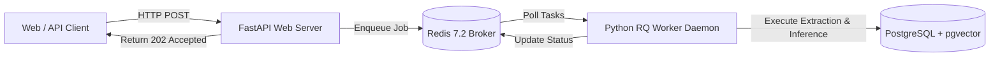

# Phase 1: Background Worker and Queue Architecture Report

**System:** Hybrid AI-Powered Multilingual Plagiarism Detection and Analysis System  
**Phase:** 1 of 7  
**Status:** Approved & Verified  
**Date:** October 2026  
**Document Version:** 1.0.0  

---

## 1. Asynchronous Architecture & Decoupling

Plagiarism detection workloads—including document OCR/parsing, Winnowing hash extraction, 768-dimensional vector inference, and cross-comparison—are computationally intensive and exceed standard HTTP request timeouts (typically 30–60 seconds). 

To ensure high availability and responsiveness:
1. HTTP API endpoints accept submissions and immediately return an `analysis_id` with job state `QUEUED`.
2. Execution is dispatched to background queues managed by **Redis 7.2** and processed by a dedicated **Python RQ (Redis Queue)** worker daemon.

---

## 2. Queue Configuration & Priorities

Three named queues are configured in `plagiarism.jobs.queue`:
1. **`high`:** Interactive user requests, single-passage queries, and health probes.
2. **`default`:** Standard document ingestion, Winnowing fingerprinting, and direct comparisons.
3. **`low`:** Batch corpus indexing, background re-embedding, and large institutional comparisons.

---

## 3. Deterministic Verification Probes

To verify worker orchestration, job dispatch, argument serialization, and failure handling without implementing Phase 2/3 algorithms, three deterministic probe tasks are implemented in `plagiarism.jobs.tasks`:

### 3.1 `ping_job(echo: str)`
* Verifies worker liveness, process ID, and bidirectional queue communication.
* Returns `{"status": "pong", "echo": echo, "timestamp": "...", "worker_pid": 1234}`.

### 3.2 `simulate_calculation(a: float, b: float, operation: str)`
* Validates math operations (`add`, `subtract`, `multiply`, `divide`) and input validation error handling (e.g. division by zero raises `ValueError`).

### 3.3 `failing_job(message: str)`
* Probes worker retry mechanisms, failed job registry, and error logging by raising `RuntimeError`.

---

## 4. Worker Lifecycle & Graceful Shutdown

The worker runner (`apps/backend/src/plagiarism/jobs/worker.py`) implements clean signal handling:
* Traps `SIGINT` (Ctrl+C) and `SIGTERM` (Docker stop).
* Allows active in-flight jobs to finish processing within a configurable timeout before exiting.
* Closes Redis connection pools gracefully to prevent lingering locks.
