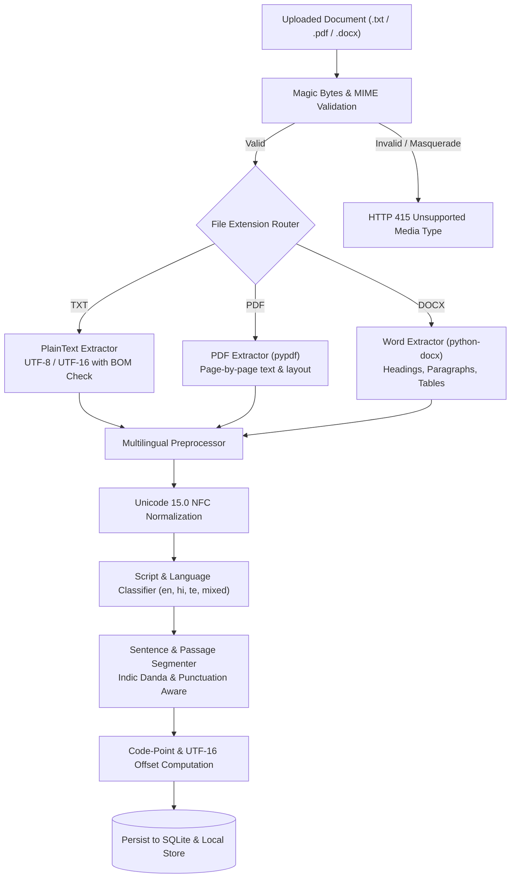

# Phase 2 — Document Processing & Multilingual Preprocessing Design

**Project:** Hybrid AI-Powered Multilingual Plagiarism Detection and Analysis System  
**Phase:** Phase 2  
**Topic:** Parsing, Extraction, Normalization, Tokenization, Offset Mapping, and Segmentation  

---

## 1. Multi-Format Text Extraction Pipeline

The document ingestion subsystem processes heterogeneous source documents into clean, structured textual streams while capturing essential metadata.



### 1.1 Plaintext Extractor (`PlainTextExtractor`)
- Supports UTF-8, UTF-8-SIG (BOM), UTF-16 Little Endian (LE), and UTF-16 Big Endian (BE).
- Detects encoding dynamically using byte-order marks (BOM) or fallback sequence probing.
- Preserves raw character formatting and line breaks.

### 1.2 PDF Extractor (`PdfExtractor`)
- Built using `pypdf`.
- Iterates over all pages sequentially, extracting textual tokens while inserting canonical form feed / newline page delimiters (`\n\n--- Page N ---\n\n`).
- Computes exact page counts and aggregates total extracted characters.
- Defends against malformed PDFs by trapping `pypdf.errors.PdfReadError`.

### 1.3 Word DOCX Extractor (`DocxExtractor`)
- Built using `python-docx`.
- Extracts structured content across multiple document elements:
  - Paragraphs and Headings (preserving structural ordering).
  - Data Tables (extracts all cells across rows with tab-delimited formatting).
- **Security Defenses:**
  - Zip bomb prevention: enforces compression ratio bounds and maximum decompressed size limits.
  - XML external entity (XXE) mitigation: defuses entity expansion during document unpacking.

---

## 2. Multilingual Normalization & NLP Pipeline

A critical vulnerability in multilingual plagiarism detection is representation mismatch caused by Unicode decomposition or incompatible tokenization of Brahmic scripts.

### 2.1 Unicode Normalization (NFC)
The system applies **Canonical Decomposition followed by Canonical Composition (NFC)** using Python's `unicodedata.normalize('NFC', text)`.
- Recombines precomposed characters and ensures identical byte representation across different OS upload sources (e.g., macOS NFD vs Windows NFC).
- Preserves all combining marks, accents, and diacritics without loss of information.

### 2.2 Script Identification & Multilingual Detection
The preprocessor inspects Unicode character ranges to classify scripts:
- **Latin:** `U+0000` to `U+007F`, `U+0080` to `U+024F`
- **Devanagari (Hindi):** `U+0900` to `U+097F`
- **Telugu:** `U+0C00` to `U+0C7F`

Script ratios are tallied across the text:
$$\text{Ratio}(S) = \frac{\sum_{c \in \text{Text}} \mathbb{I}(c \in S)}{\text{Total Alphabetic Characters}}$$
- If $\text{Ratio}(\text{Devanagari}) > 0.35 \implies \text{detected\_language} = \text{'hi'}$
- If $\text{Ratio}(\text{Telugu}) > 0.35 \implies \text{detected\_language} = \text{'te'}$
- If $\text{Ratio}(\text{Latin}) > 0.60 \implies \text{detected\_language} = \text{'en'}$
- Otherwise $\implies \text{detected\_language} = \text{'mixed'}$

### 2.3 Brahmic Script Integrity (Matras & Viramas)
In standard regular expressions, tokenizing on `\w+` fails severely in Indic languages because standard ASCII word regexes split words on non-spacing combining marks (matras) or halants/viramas.
Our preprocessor uses an Indic-safe Unicode regex:
```python
INDIC_TOKEN_PATTERN = re.compile(r'[^\s,.!?;:\'\"()\[\]{}«»—–।॥/\\]+', re.UNICODE)
```
This guarantees that complex syllables such as `"साहित्यिक"` and `"విశ్లేషణ"` are captured as unified tokens rather than being broken into fragments.

---

## 3. Offset Mapping & Deterministic Segmentation

### 3.1 Dual-Coordinate Offset System
To ensure flawless visual alignment in Phase 6 web interfaces without off-by-one errors across UTF-8, UTF-16, and Python internal strings:
1. **Python Character Code Points (`start_char`, `end_char`):**
   - 0-indexed Unicode scalar values.
   - Guaranteed slicing integrity in Python: `raw_text[start_char:end_char] == passage_text`.
2. **JavaScript UTF-16 Code Units (`start_utf16`, `end_utf16`):**
   - 0-indexed UTF-16 code units used by browser DOM and JavaScript strings (`String.prototype.slice()`).
   - For characters outside the Basic Multilingual Plane (BMP, e.g. astral symbols, emojis), 1 Unicode code point equals 2 UTF-16 code units (surrogate pairs).
   - Our offset helper tracks surrogate pairs dynamically:
     $$\text{utf16\_units}(c) = \begin{cases} 2 & \text{if } \text{ord}(c) > \text{0xFFFF} \\ 1 & \text{otherwise} \end{cases}$$

### 3.2 Sentence Boundary Detection
Sentence splitting accounts for both Western and Indic punctuation:
- Latin: `.`, `!`, `?`
- Devanagari: Danda (`।` - `U+0964`) and Double Danda (`॥` - `U+0965`)
- Telugu: Standard sentence terminal markers and Danda variants

### 3.3 Deterministic Passage Chunking
Passages are segmented deterministically:
- Target window: 150 to 250 words per passage.
- Sentences are accumulated into the active passage until the word threshold is reached.
- Boundary condition: A passage never splits a sentence in half unless a single isolated sentence exceeds 300 words.
- Every generated passage record stores its absolute start and end offsets mapped directly back into the unnormalized source text.
