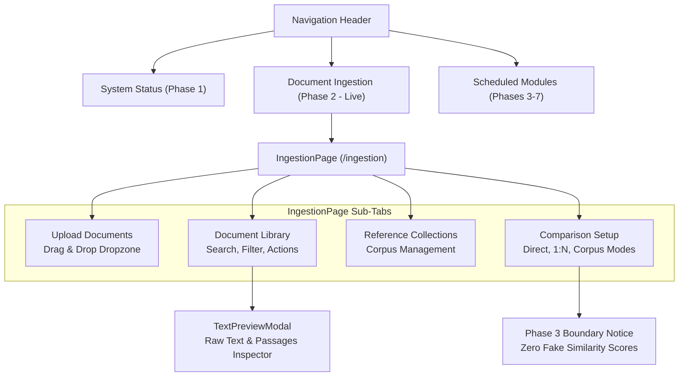

# Phase 2 — Frontend Architecture & UI Verification Report

**Project:** Hybrid AI-Powered Multilingual Plagiarism Detection and Analysis System  
**Phase:** Phase 2  
**Tech Stack:** React 18.3, TypeScript 5.5, Vite 5.4, Tailwind CSS 3.4, Vitest 2.1  
**Target URL:** `http://127.0.0.1:5173`  

---

## 1. Overview & UI Architecture

Phase 2 introduces the complete **Document Ingestion & Management Subsystem** into the existing React 18 single-page application. The user interface provides researchers and academic evaluators with full visibility and control over document ingestion, text extraction, linguistic analysis, passage segmentation, corpus organization, and comparison validation.



---

## 2. Key UI Modules & Components

### 2.1 Navigation Header (`Navigation.tsx`)
- Activated the `Document Ingestion` tab by setting `isLive: true` and pointing to the `ingestion` view.
- Maintained scheduled placeholders for future phases (`Lexical Detection`, `Semantic Analysis`, `Cross-Language`, `Dual-Pane Viewer`, `Evaluation Workbench`).

### 2.2 Ingestion Workspace (`IngestionPage.tsx`)
1. **Sub-Tab 1: Upload Documents**
   - Drag-and-drop file upload zone supporting `.txt`, `.pdf`, `.docx` up to 30 MB.
   - Optional title and language hint selection (`Auto Detect`, `English`, `Hindi`, `Telugu`).
   - Real-time upload progress, file validation error banners, and success feedback.
2. **Sub-Tab 2: Document Library**
   - Tabular view of all ingested documents displaying: filename, title, detected language/script, file size, page count, word count, character count, and processing status badges (`Completed`, `Processing`, `Queued`, `Failed`).
   - Integrated search filter across titles and filenames.
   - Action triggers:
     - **Inspect Raw Text & Passages:** Opens `TextPreviewModal`.
     - **Delete Document:** Dispatches cascade deletion with immediate table update.
3. **Sub-Tab 3: Reference Collections**
   - Create new benchmark corpora with custom names and descriptions.
   - Add reference documents to collections or remove existing members.
   - Document count badges and creation timestamps.
4. **Sub-Tab 4: Comparison Setup**
   - Multi-mode selection: Direct (1:1), One-to-Many (1:N), and Corpus (1:Collection).
   - Candidate submission document dropdown.
   - Dynamic target selection based on active mode.
   - **Validation Trigger:** Submits selection to `/api/v1/comparisons/validate` and renders honest feedback banner:
     > *"Documents are ready for analysis. Similarity detection will be implemented in Phase 3."*

### 2.3 Raw Text & Passage Inspector (`TextPreviewModal.tsx`)
- Dual-tabbed modal:
  1. **Raw Text Tab:** Displays exact unnormalized extracted text, character count, word count, and detected language.
  2. **Passages Tab:** Displays deterministic segmented passages with sequence numbers, word/token counts, and character code-point offset intervals (`[start_char : end_char]`).

---

## 3. Automated Frontend Test Suite (Vitest)

All frontend unit tests execute under Vitest 2.1.9 using `@testing-library/react` with Happy-DOM:
- `tests/client.test.ts`: 3 tests verifying typed API client communication.
- `tests/Header.test.tsx`: 3 tests verifying navigation and system branding.
- `tests/IngestionPage.test.tsx`: 4 tests verifying file upload UI, document library rendering, collection creation, and comparison validation.
- `tests/App.test.tsx`: 3 tests verifying view switching, Phase 2 activation, and modal behavior.

**Summary:** 4 test files, 13 passed tests (100% pass rate).

---

## 4. Production Bundle Verification (`vite build`)

```
vite v5.4.21 building for production...
✓ 1582 modules transformed.
dist/index.html                   0.56 kB │ gzip:  0.37 kB
dist/assets/index-D5Mf0RsA.css   23.26 kB │ gzip:  4.80 kB
dist/assets/index-S8BMlkiD.js   211.70 kB │ gzip: 61.34 kB
✓ built in 4.37s
```
Zero build warnings, zero TypeScript errors (`tsc --noEmit` clean).
