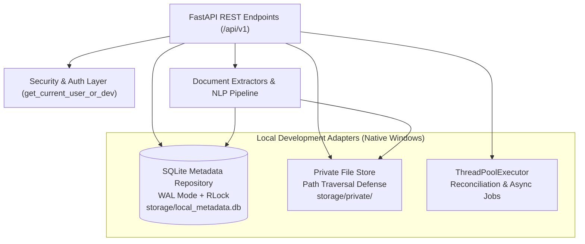

# Phase 2 — Local Development Adapters: Storage, Database, and Worker Architecture

**Project:** Hybrid AI-Powered Multilingual Plagiarism Detection and Analysis System  
**Phase:** Phase 2  
**Topic:** Zero-Virtualization Localhost Adapters (SQLite, Private FS Store, ThreadPoolExecutor)  

---

## 1. Architectural Strategy & Rationale

Per user directives on Windows 11 development, container virtualization (Docker Desktop, WSL2) and external infrastructure daemons (PostgreSQL, Redis) are postponed until deployment phases.

To enable rigorous, fully functional development and testing without virtualization, Phase 2 implements a clean **Adapter Architecture**. The business logic, services, schemas, and REST controllers interact through standard abstractions. In local development mode (`APP_RUNTIME_MODE = 'local'`), the system binds to native Windows localhost adapters that mimic production semantics with zero external service dependencies.



---

## 2. Adapter 1: SQLite Metadata Repository (`local_db.py`)

### Concurrency & Thread-Safety Design
SQLite in a multi-threaded web server (`uvicorn` with multiple workers or async threadpools) can suffer from database locks or race conditions if not configured properly.
Our adapter employs:
1. **Write-Ahead Logging (`PRAGMA journal_mode=WAL;`):** Allows concurrent readers while a write is occurring.
2. **Synchronous Normal (`PRAGMA synchronous=NORMAL;`):** Provides optimal durability and performance on NTFS filesystems.
3. **Foreign Keys Enforcement (`PRAGMA foreign_keys=ON;`):** Ensures relational integrity and automatic cascade deletes across document sources, passages, and collection links.
4. **Reentrant Lock (`threading.RLock()`):** Standard `threading.Lock()` causes deadlocks when a method (e.g. `insert_document`) acquires the lock and subsequently invokes another method (e.g. `get_document`) on the same thread. `RLock` allows reentrant acquisition by the same thread while blocking competing threads.

### Schema Definitions
- `documents`: Primary record containing document ID (UUIDv4), user ID, filename, SHA-256 hash, MIME type, byte size, detected language, script, status (`queued`, `processing`, `completed`, `failed`), raw char/word/page/paragraph counts, and error messages.
- `document_sources`: Tracks raw file on-disk storage path, upload timestamp, and original filename.
- `passages`: Stores segmented text chunks, chunk sequence index, start/end character code points, start/end UTF-16 code units, unnormalized text snippet, and token count.
- `collections`: Reference corpora records (ID, user ID, name, description, timestamps).
- `collection_documents`: Many-to-many relationship table linking reference documents to collections.

### Startup Job Reconciliation
If the backend process terminates unexpectedly while a document is in `processing` state, orphaned jobs would remain stuck in limbo forever. On startup, `LocalMetadataRepository` executes:
```sql
UPDATE documents 
SET status = 'failed', error_message = 'Ingestion interrupted by server restart' 
WHERE status IN ('queued', 'processing');
```

---

## 3. Adapter 2: Private Filesystem Storage (`private_store.py`)

### Security & Path Traversal Prevention
The local file storage adapter persists uploaded binary files to `storage/private/`. To eliminate directory traversal vulnerabilities (e.g., `../../Windows/System32`):
1. **Path Resolution Confinement:** Resolves target paths using `Path.resolve()` and explicitly validates:
   ```python
   resolved.relative_to(self.base_dir.resolve())
   ```
   Any attempt to escape the designated storage root raises an immediate `ValueError("Path traversal attempt detected")`.
2. **Content-Addressable File Naming:** Files are stored using secure UUIDv4 filenames rather than raw user-supplied filenames, neutralizing special characters, spaces, and Windows reserved filenames (`CON`, `PRN`, `AUX`, `NUL`).
3. **On-the-Fly SHA-256 Hashing:** The storage writer streams incoming byte chunks while updating a `hashlib.sha256()` accumulator, avoiding loading entire multi-megabyte payloads into memory.
4. **Size Enforcement:** Tracks total bytes streamed and enforces `MAX_UPLOAD_SIZE_BYTES` (30 MB limit) dynamically, aborting immediately if exceeded.

---

## 4. Adapter 3: In-Memory Thread Pool Executor (`executor.py`)

### Queue and Asynchronous Task Execution
While production leverages Redis + RQ / Celery, local mode employs Python's standard library `concurrent.futures.ThreadPoolExecutor(max_workers=4)`.
- **Status Lifecycle:** Transition from `queued` $\to$ `processing` $\to$ `completed` or `failed`.
- **Synchronous Override:** For automated test suites and CLI acceptance runners, an optional query flag `sync_processing=true` executes the ingestion workflow synchronously on the calling thread, guaranteeing immediate test assertions without flaky time delays.

---

## 5. Transition Path to Production (Phase 7)

| Local Adapter (Phase 2) | Production Infrastructure (Phase 7) | Migration Effort |
| :--- | :--- | :--- |
| `LocalMetadataRepository` (SQLite) | PostgreSQL 16 + pgvector (SQLAlchemy ORM) | Repositories share clean interface; drop-in swap |
| `LocalPrivateStore` (Local FS) | Encrypted S3 / MinIO Object Storage | Abstract StorageService interface preserved |
| `LocalTaskExecutor` (ThreadPool) | Redis 7 + RQ / Celery Workers | Task payload serialization schema already identical |
| `get_current_user_or_dev` (Dev Auth) | Keycloak / JWT Bearer Tokens | Production token validation already active and tested |
