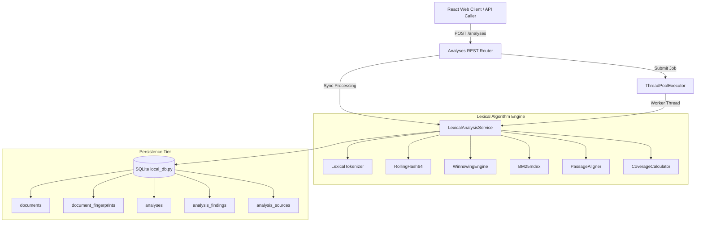
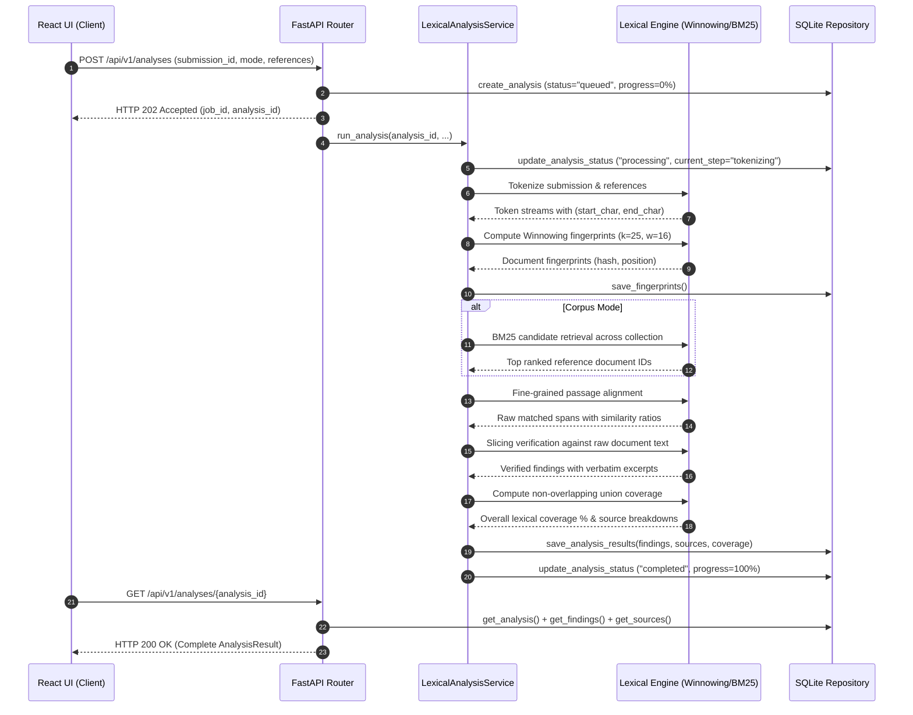

# Phase 3 Architecture and Processing Pipeline

## 1. Architectural Philosophy

Phase 3 implements the lexical detection tier within the modular monolith architecture outlined in ADR-0001. The pipeline strictly operates on native Windows 11 hardware without virtualization, leveraging Python's CPU efficiency for deterministic algorithm calculations and SQLite for transactional persistence.

### Key Architectural Tenets:
1. **Explainable Evidence**: Plagiarism scores are strictly substantiated by inspectable string matches with exact character start/end coordinates. No "black box" numbers.
2. **Deterministic Reproducibility**: Given document $A$ and document $B$, running the pipeline multiple times across reboots yields identical fingerprints, identical matches, and identical coverage percentages.
3. **Strict Separation of Concerns**: Algorithm implementations (`services/lexical/`) have zero coupling to HTTP request handling or database logic. They accept plain text or tokens and return typed mathematical primitives.
4. **Boundary Isolation**: Lexical similarity calculates verbatim and near-verbatim string overlap. Dense vector semantic embeddings and cross-lingual translation are explicitly deferred to Phase 4.

---

## 2. Component Design & Module Architecture

---

## 3. End-to-End Execution Sequence

---

## 4. Pipeline Execution States

Analyses transition through well-defined lifecycle states:
- `queued`: Record created in SQLite; job scheduled on worker executor.
- `processing`: Worker thread actively computing hashes, candidate rankings, or alignments.
  - Step: `loading_documents`
  - Step: `tokenizing_and_fingerprinting`
  - Step: `retrieving_candidates`
  - Step: `aligning_passages`
  - Step: `calculating_coverage`
  - Step: `persisting_results`
- `completed`: Pipeline finished successfully; results persisted.
- `failed`: An unhandled exception occurred; `error_message` is recorded in SQLite.
- `cancelled`: Explicit user termination via `POST /analyses/{id}/cancel`.
