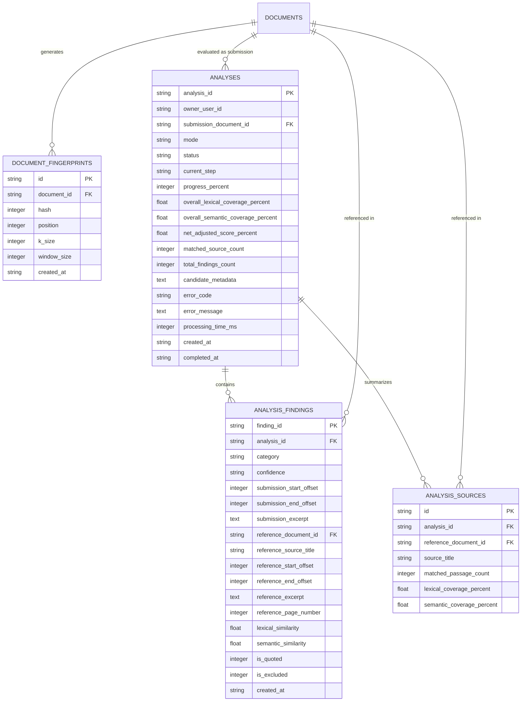

# Database and Index Design: Phase 3 Relational Extensions

## 1. Relational Schema Architecture

Phase 3 extends the local SQLite database (`storage/local_db.py`) to store document fingerprints, analysis run configurations, granular plagiarism findings, and per-source coverage breakdowns.



---

## 2. Table DDL Definitions

```sql
CREATE TABLE IF NOT EXISTS document_fingerprints (
    id TEXT PRIMARY KEY,
    document_id TEXT NOT NULL,
    hash INTEGER NOT NULL,
    position INTEGER NOT NULL,
    k_size INTEGER NOT NULL,
    window_size INTEGER NOT NULL,
    created_at TEXT NOT NULL,
    FOREIGN KEY(document_id) REFERENCES documents(document_id) ON DELETE CASCADE
);

CREATE TABLE IF NOT EXISTS analyses (
    analysis_id TEXT PRIMARY KEY,
    owner_user_id TEXT NOT NULL,
    submission_document_id TEXT NOT NULL,
    mode TEXT NOT NULL,
    status TEXT NOT NULL,
    current_step TEXT,
    progress_percent INTEGER DEFAULT 0,
    overall_lexical_coverage_percent REAL DEFAULT 0.0,
    overall_semantic_coverage_percent REAL DEFAULT 0.0,
    net_adjusted_score_percent REAL DEFAULT 0.0,
    matched_source_count INTEGER DEFAULT 0,
    total_findings_count INTEGER DEFAULT 0,
    candidate_metadata TEXT,
    error_code TEXT,
    error_message TEXT,
    processing_time_ms INTEGER,
    created_at TEXT NOT NULL,
    completed_at TEXT,
    FOREIGN KEY(submission_document_id) REFERENCES documents(document_id) ON DELETE CASCADE
);

CREATE TABLE IF NOT EXISTS analysis_findings (
    finding_id TEXT PRIMARY KEY,
    analysis_id TEXT NOT NULL,
    category TEXT NOT NULL,
    confidence TEXT NOT NULL,
    submission_start_offset INTEGER NOT NULL,
    submission_end_offset INTEGER NOT NULL,
    submission_excerpt TEXT NOT NULL,
    reference_document_id TEXT NOT NULL,
    reference_source_title TEXT NOT NULL,
    reference_start_offset INTEGER NOT NULL,
    reference_end_offset INTEGER NOT NULL,
    reference_excerpt TEXT NOT NULL,
    reference_page_number INTEGER DEFAULT 1,
    lexical_similarity REAL DEFAULT 1.0,
    semantic_similarity REAL DEFAULT 0.0,
    is_quoted INTEGER DEFAULT 0,
    is_excluded INTEGER DEFAULT 0,
    created_at TEXT NOT NULL,
    FOREIGN KEY(analysis_id) REFERENCES analyses(analysis_id) ON DELETE CASCADE,
    FOREIGN KEY(reference_document_id) REFERENCES documents(document_id) ON DELETE CASCADE
);

CREATE TABLE IF NOT EXISTS analysis_sources (
    id TEXT PRIMARY KEY,
    analysis_id TEXT NOT NULL,
    reference_document_id TEXT NOT NULL,
    source_title TEXT NOT NULL,
    matched_passage_count INTEGER NOT NULL,
    lexical_coverage_percent REAL NOT NULL,
    semantic_coverage_percent REAL DEFAULT 0.0,
    FOREIGN KEY(analysis_id) REFERENCES analyses(analysis_id) ON DELETE CASCADE,
    FOREIGN KEY(reference_document_id) REFERENCES documents(document_id) ON DELETE CASCADE
);
```

---

## 3. High-Performance Index Design

To ensure fast fingerprint lookup across millions of hashes, the following indexes are maintained:

```sql
CREATE INDEX IF NOT EXISTS idx_doc_fingerprints_doc ON document_fingerprints(document_id);
CREATE INDEX IF NOT EXISTS idx_doc_fingerprints_hash ON document_fingerprints(hash);
CREATE INDEX IF NOT EXISTS idx_analyses_owner ON analyses(owner_user_id);
CREATE INDEX IF NOT EXISTS idx_analyses_submission ON analyses(submission_document_id);
CREATE INDEX IF NOT EXISTS idx_findings_analysis ON analysis_findings(analysis_id);
CREATE INDEX IF NOT EXISTS idx_sources_analysis ON analysis_sources(analysis_id);
```

### Fingerprint Lookup Query
Querying shared fingerprints between a candidate document and a set of reference documents executes via index intersection:
```sql
SELECT f.document_id, f.hash, f.position 
FROM document_fingerprints f
WHERE f.hash IN (?, ?, ...)
  AND f.document_id IN (?, ?, ...)
```

---

## 4. Boot-time Job Reconciliation & Deletion Cascades

### 1. Interrupted Job Reconciliation
If the backend process terminates unexpectedly while an analysis job is in `queued` or `processing` state, `LocalMetadataRepository.reconcile_incomplete_jobs()` automatically identifies these orphaned states on next startup and marks them as `failed` with:
- `error_code = "INTERRUPTED_BY_SHUTDOWN"`
- `error_message = "Analysis job was interrupted by backend process shutdown or restart."`

### 2. Cascading Deletion
When `repo.delete_analysis(analysis_id)` is invoked, SQLite foreign key cascades automatically purge:
1. All findings from `analysis_findings` matching `analysis_id`.
2. All source breakdowns from `analysis_sources` matching `analysis_id`.
3. The parent row in `analyses`.
No orphan records remain.
