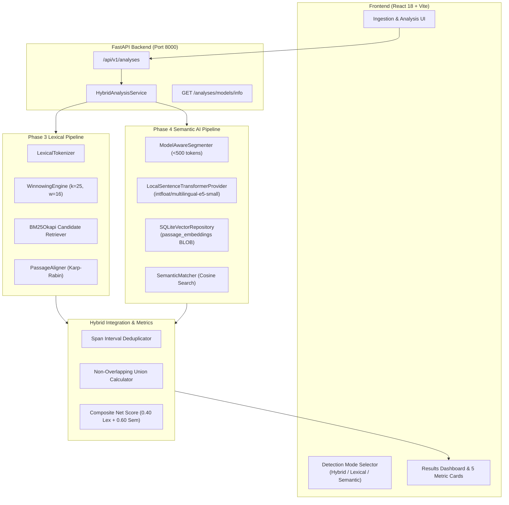

# Phase 4 Architecture & Pipeline: Hybrid AI Plagiarism Detection

## 1. System Architecture Overview

The Phase 4 engine operates as a multi-tier hybrid architecture combining deterministic lexical matching with dense multilingual vector embeddings. The design guarantees high precision for verbatim duplication while capturing subtle conceptual paraphrases and cross-language translations.

---

## 2. Ingestion to Semantic Indexing Flow

When reference documents are ingested or compared:

1. **Document Loading**: Text is retrieved from SQLite metadata and private filesystem storage.
2. **Model-Aware Segmentation**: `ModelAwareSegmenter` evaluates passage token counts against the tokenizer's budget. Passages exceeding 500 tokens are cleanly split along sentence boundaries (`split_sentences_with_offsets`) while preserving exact Unicode code-point offsets into the original text.
3. **Passage Embedding Generation**: Each passage is prefixed with `passage: ` and encoded via `LocalSentenceTransformerProvider` into a 384-dimensional $L_2$-normalized float32 vector.
4. **Persistent Vector Storage**: Vectors are serialized to raw IEEE 754 float32 byte buffers (`tobytes()`) and stored in the SQLite `passage_embeddings` table with foreign key cascading to `documents(document_id)`.

---

## 3. Query Execution & Candidate Search Flow

1. **Query Passage Extraction**: The submission document is segmented into query passages.
2. **Query Vector Encoding**: Passages are prefixed with `query: ` and encoded into normalized query vectors.
3. **Dense Candidate Retrieval**: `SQLiteVectorRepository.search_candidates` computes vectorized inner-product cosine similarity across candidate document passage vectors:
   $$\text{Cosine}(q, p) = q \cdot p \quad (\text{since } \|q\|_2 = \|p\|_2 = 1.0)$$
4. **Calibrated Filtering**: Findings are filtered using empirical thresholds:
   - Paraphrases (same language): Cosine $\ge 0.82$.
   - Potential Translations (cross-language): Cosine $\ge 0.80$.
   - Hard negatives below these cutoffs are strictly rejected.

---

## 4. Hybrid Evidence Integration & Union Coverage

The system reconciles lexical and semantic findings into a unified, explainable evidence model:

- **Token Interval Projection**: Character offsets of semantic findings are mapped to token intervals in the submission document.
- **Span Deduplication**: Overlapping verbatim lexical matches and semantic paraphrases are merged so that identical regions are not counted twice.
- **Coverage Separation**:
  - `overall_lexical_coverage_percent`: Exact verbatim token overlap.
  - `overall_semantic_coverage_percent`: Paraphrased and translated passage coverage.
  - `hybrid_evidence_coverage_percent`: Non-overlapping union ($L \cup S$) of flagged text spans.
  - `net_adjusted_score_percent`: Institutional weighted composite:
    $$\text{Net Score} = 0.40 \times \text{Lexical Coverage} + 0.60 \times \text{Semantic Coverage}$$
