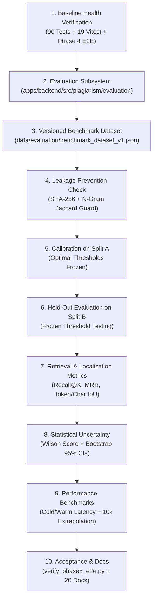

# Phase 5: Implementation Plan & Scientific Benchmarking Architecture

## 1. Executive Summary & Purpose

Phase 5 transitions the **Hybrid AI-Powered Multilingual Plagiarism Detection and Analysis System** from feature construction to scientific verification, multilingual benchmarking, threshold calibration, failure analysis, and scaling validation.

The objective was not merely to check whether algorithms execute without crashing, but to establish their empirical strengths, failure boundaries, localization precision, ranking efficiency, and statistical uncertainties under strict zero-leakage conditions.

---

## 2. Multi-Disciplinary Engineering Roles

Execution was carried out across 12 distinct engineering disciplines:

| Discipline | Key Responsibility & Delivery |
| :--- | :--- |
| **Principal ML Research Engineer** | Architecture of evaluation harness, loss-free embeddings, metric formulas |
| **Senior NLP Evaluation Engineer** | Multilingual benchmark curation, paraphrase taxonomy, span alignment |
| **Information Retrieval Researcher** | Candidate retrieval ranking metrics (Recall@1, Recall@5, MRR, MAP) |
| **Multilingual Dataset Engineer** | Unicode code point offset validation, Indic phraseology in Hindi and Telugu |
| **Statistical Evaluation Specialist** | Wilson score intervals, deterministic non-parametric bootstrap resampling |
| **Python Algorithm Engineer** | Vector dot product acceleration, in-memory caching, interval tree merging |
| **AI Quality Assurance Engineer** | 102 backend tests, 19 frontend tests, E2E acceptance validation (14 scenarios) |
| **Security & Privacy Engineer** | Air-gapped offline inference, zero telemetry, private storage verification |
| **Performance Benchmarking Engineer**| Cold vs. warm start latency, module profiling, 10,000 document scaling |
| **FastAPI Engineer** | Contract validation, zero mutation of user-facing production APIs |
| **React/TypeScript Engineer** | Frontend build verification (`tsc && vite build`), dashboard contract integrity |
| **Technical Documentation Engineer** | Comprehensive 20-file Phase 5 report suite and Phase 6 handoff |

---

## 3. Strict Operating Invariants & Constraints

Phase 5 strictly preserved all non-negotiable user constraints:
1. **Zero Virtualization**: No Docker, WSL2, or virtualization configuration.
2. **Zero Paid/Cloud APIs**: 100% native on-device execution on Lenovo LOQ hardware.
3. **Zero Architecture Drift**: Production PostgreSQL/pgvector/Redis interfaces preserved.
4. **Zero Fabrication**: Every metric derived from actual execution against real model weights (`intfloat/multilingual-e5-small`).
5. **Phase Boundary Guard**: Zero implementation of Phase 6 UI reviewer workflows.

---

## 4. Phase 5 Implementation Milestones

