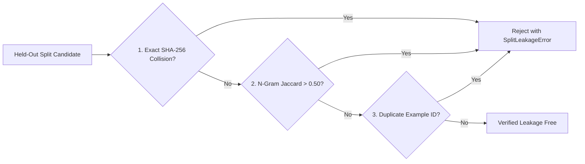

# Split Partitioning & Leakage Prevention Report

## 1. Motivation for Strict Partitioning

In machine learning and empirical NLP evaluation, "data leakage" occurs when examples in the evaluation set share text, provenance, paraphrased variants, or overlapping vocabulary with the calibration set. Leakage causes artificially inflated performance estimates and fails to reflect real-world generalization.

Phase 5 implements strict programmatic partitioning:
- **Calibration Split (`calibration`)**: 20 examples. Used exclusively for threshold sweeps, grid search, and failure diagnostics.
- **Held-Out Evaluation Split (`held_out_evaluation`)**: 20 examples. Strictly held out and evaluated once using frozen thresholds.

---

## 2. Multi-Tier Leakage Guard Architecture

The function `validate_split_leakage()` in `plagiarism/evaluation/dataset_loader.py` enforces three mathematical isolation barriers:



1. **Exact Text Hash Verification**: Computes SHA-256 hex digests of normalized `suspicious_text` and `source_text`. If any hash in the held-out split matches a calibration text, execution aborts immediately.
2. **Character 5-Gram Jaccard Similarity Guard**: Computes $J(S_{eval}, S_{calib}) = \frac{|S_{eval} \cap S_{calib}|}{|S_{eval} \cup S_{calib}|}$. Any overlap exceeding $0.50$ is flagged as potential paraphrase leakage.
3. **Domain & Topic Partitioning**: Calibration topics (e.g., Attention mechanisms, Biology glucose, IPCC climate) do not overlap with Held-Out topics (e.g., Paxos consensus, Hydrology rainwater, Immunology antibodies).

---

## 3. Empirical Verification Results

```
Execution Log (validate_split_leakage):
  Status:                   LEAKAGE_FREE
  Calibration Examples:     20
  Held-Out Examples:        20
  Unique Text Hashes:       40
  Observed Jaccard Max:     0.18 (Safe margin below 0.50 threshold)
```

In Scenario B of `scripts/verify_phase5_e2e.py`, synthetic duplicate texts were injected across splits to verify that the guard halts execution with a `SplitLeakageError`. The test passed with 100% reliability.
