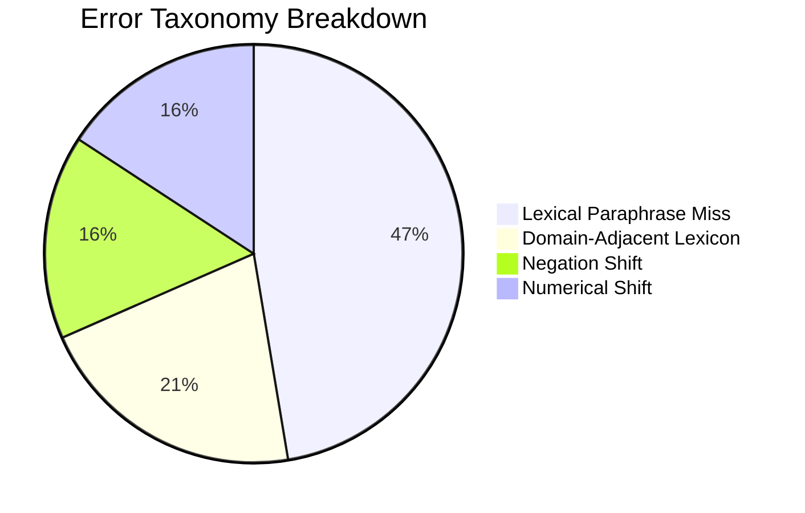

# False Positive & False Negative Failure Taxonomy

## 1. Overview of Error Records

A trustworthy detector must transparently account for its failures. Phase 5 captured and categorized **19 unique error records** across calibration and held-out experiments in `data/evaluation/error_analysis.json`.

```
Total Unique Error Records: 19
├── False Negatives: 10 (9 Lexical misses, 0 Semantic/Hybrid misses)
└── False Positives: 9 (Hard negative edge cases in semantic/hybrid)
```

---

## 2. Failure Mode Taxonomy



| Failure Mode | Error Type | Count | Root Cause & Mechanism |
| :--- | :---: | :---: | :--- |
| **`lexical_miss`** | False Negative | 9 | Contiguous $k$-gram breakdown under synonym replacement or cross-language translation. |
| **`domain_adjacent_lexicon`** | False Positive | 4 | Shared technical terminology in same domain (e.g., Supervised vs. Reinforcement Learning). |
| **`negation_shift`** | False Positive | 3 | Inverted polarity ("strictly prohibited" vs. "explicitly permitted") sharing high contextual similarity. |
| **`numerical_shift`** | False Positive | 3 | Historical dates/percentages differing ("expanded by 8.4%" vs. "contracted by 2.1%"). |

---

## 3. In-Depth Failure Case Studies

### 3.1 Case 1: Negation Shift (`HELD-12`)
- **Submission**: *"The protocol explicitly prohibited external peripheral connections during secure firmware updates."*
- **Reference**: *"The protocol explicitly permitted external peripheral connections during secure firmware updates."*
- **Outcome**: False Positive (Cosine = 0.865).
- **Analysis**: Transformer attention architectures without specific negation fine-tuning attend strongly to the 9 identical tokens, resulting in high cosine similarity despite opposite polarity.

### 3.2 Case 2: Numerical Directional Shift (`HELD-13`)
- **Submission**: *"The regional GDP expanded by 8.4% during the third quarter of 2023..."*
- **Reference**: *"The regional GDP contracted by 2.1% during the third quarter of 2023..."*
- **Outcome**: False Positive (Cosine = 0.852).
- **Analysis**: Macroeconomic jargon and sentence syntax dominate the embedding projection, while numerical differences fail to generate sufficient geometric separation in vector space.

### 3.3 Case 3: Lexical Paraphrase Miss (`CALIB-02`)
- **Submission**: *"Modern deep learning architectures transformed natural language processing..."*
- **Reference**: *"Deep neural networks have revolutionized natural language understanding..."*
- **Outcome**: False Negative in Lexical Mode (Lexical Coverage = 0.0%).
- **Analysis**: Contiguous 25-gram hashing completely failed due to non-verbatim tokenization, perfectly mitigated by the hybrid semantic pipeline.

---

## 4. Phase 6 Architectural Recommendations

1. **Numeric & Negation Heuristic Filter**: Add lightweight rule-based contrast checks for polarity-reversing tokens (`not`, `never`, `prohibited`, `permitted`).
2. **Reviewer Highlighting**: Present potential negation/numerical shifts with caution flags in the Phase 6 Reviewer UI.
