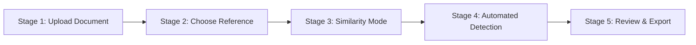

# Phase 6 — Five-Stage User Workflow

## 1. Overview
The primary interaction pattern implements a clean, guided 5-stage progressive disclosure journey:

## 2. Detailed Breakdown

### Stage 1: Central Upload Hero
- **Interaction:** Drag-and-drop or file picker accepting PDF (`application/pdf`), DOCX (`application/vnd.openxmlformats-officedocument.wordprocessingml.document`), or TXT (`text/plain`).
- **Guidance:** Formats clearly stated with explicit support for English, Hindi, and Telugu.
- **Feedback:** Real-time upload progress bar with auto-transition to Stage 2 upon file ingestion.

### Stage 2: Reference Comparison Selection
- **Mode A (Direct File Compare):** Drag-and-drop or pick a specific reference document.
- **Mode B (Library Selection):** Select an existing document from the user's private library.
- **Progressive Unlocking:** Stage 3 activates only when both submission and comparison target are specified.

### Stage 3: Similarity Engine Configuration
- **Hybrid (Recommended):** Merges Winnowing lexical matching and Multilingual E5 dense semantic retrieval.
- **Lexical Only:** High-speed deterministic verbatim matching via rolling hashes.
- **Semantic Only:** Deep paraphrase and cross-lingual translation detection.

### Stage 4: Execution Progress
- Unobtrusive progress bar detailing execution steps:
  1. *Reading and normalizing document text...*
  2. *Computing Winnowing fingerprints & rolling hashes...*
  3. *Performing exact & near-exact passage alignment...*
  4. *Evaluating Multilingual E5 dense vector embeddings...*
  5. *Aggregating non-overlapping hybrid coverage & reports...*
- Direct routing to the Review Dashboard upon completion.

### Stage 5: Evidence Review & Multi-Format Export
- Interactive side-by-side inspection, inline reviewer decision actions (`keep`, `exclude`, `quoted_cited`, `needs_review`), and instant PDF/HTML/JSON report downloads.
