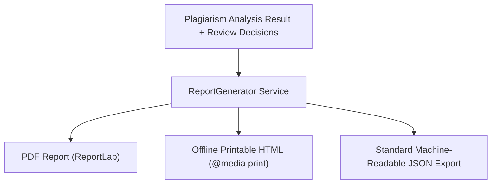

# Phase 6 — Multi-Format Report Generation

## 1. Overview
The reporting engine (`ReportGenerator` in `apps/backend/src/plagiarism/services/reports/report_generator.py`) generates formal reports across three distinct formats:

## 2. Supported Report Formats

### 1. Formal PDF Report (`format=pdf`)
- **Engine:** Python `ReportLab` (v5.0.1) with Flowable canvas layout.
- **Content:**
  - Executive header with document name, SHA-256 fingerprint, analysis timestamp, and analysis mode.
  - Reviewer Adjustment Comparison: Side-by-side metric tiles showing Original Evidence % vs. Adjusted % after Human Review.
  - Status Breakdown Pill Counts (Kept, Excluded, Quoted/Cited, Needs Review).
  - Matched Reference Sources Table.
  - Findings Cards with submitted text excerpts, matched reference excerpts, character offsets, and inline reviewer notes.
  - Legal Disclaimer and Academic Integrity Assurance footnote.
- **Headers:** `Content-Type: application/pdf`, `Content-Disposition: attachment; filename="similarity_report_<id>.pdf"`.

### 2. Standalone Offline HTML Report (`format=html`)
- **Design:** Self-contained single-file HTML document with zero external CSS or JavaScript CDN dependencies.
- **Features:**
  - Full responsive layout with clean Slate-50 / Indigo aesthetic.
  - One-click `window.print()` trigger button.
  - Dedicated `@media print` stylesheet removing navigation, optimizing margins, and ensuring high-contrast monochrome/color printer output.
- **Headers:** `Content-Type: text/html; charset=utf-8`.

### 3. Machine-Readable JSON Audit Report (`format=json`)
- **Design:** Strict JSON format for institutional archival, SIS integration, and regulatory audits.
- **Top-Level Compatibility:** Emits both root-level fields (`overall_lexical_coverage_percent`, `reviewer_adjusted_coverage_percent`, `findings`) and structured objects (`metrics`, `document`, `reviewer_summary`).
- **Headers:** `Content-Type: application/json`.
