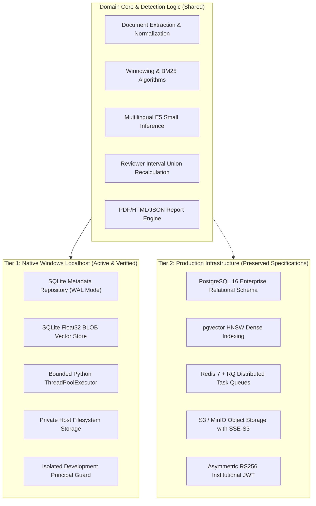

# Phase 7 — Architecture Preservation & Isolation

## 1. Dual-Architecture Coexistence Model
To satisfy the user's non-negotiable requirement for zero Docker/WSL2 and zero external server installations, the codebase strictly maintains two isolated execution tiers:

## 2. Preservation Audit
- **Alembic Migrations:** Preserved in `infra/migrations/` and `apps/backend/alembic/`.
- **Docker Compose:** Preserved in `compose.yml` for future production containerization.
- **Contract Integrity:** Preserved in `contracts/openapi.yaml`.
- **Database Schema Equivalence:** The local SQLite tables mirrors the primary entities, columns, and foreign keys of the production PostgreSQL schema.
