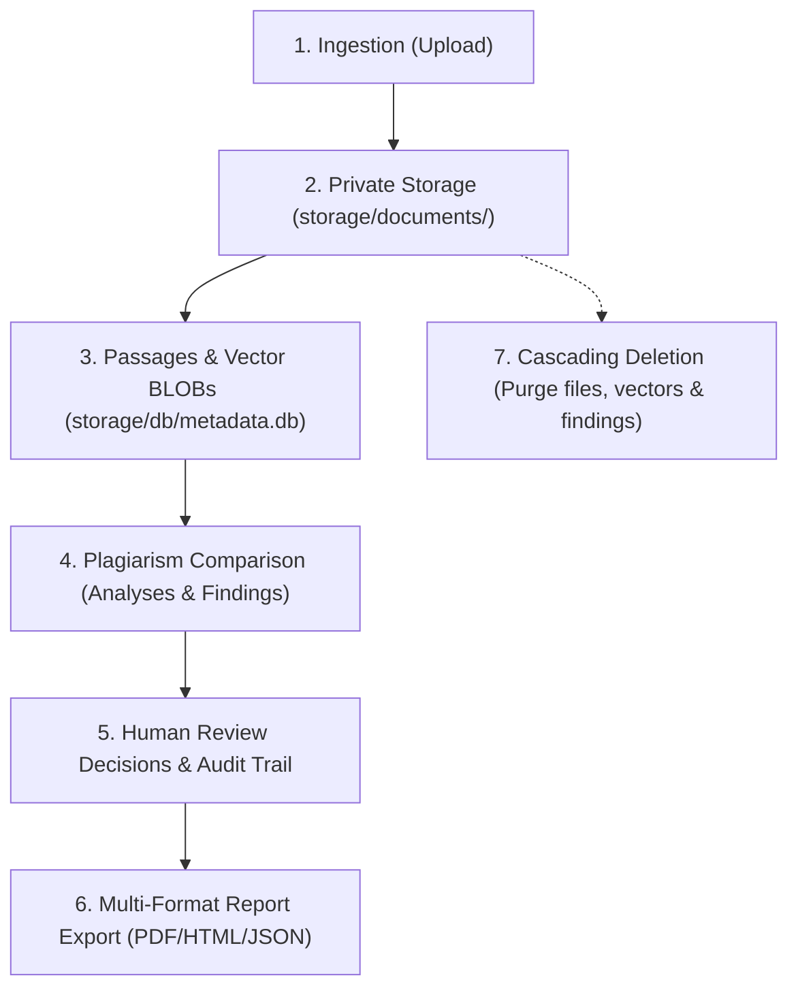

# Phase 7 — Privacy & Document Lifecycle

## 1. Document Lifecycle Management
The application implements an explicit, safe lifecycle across user documents:

## 2. Foreign Key Cascading Deletion
- Executing `DELETE /api/v1/documents/{document_id}` triggers cascading cleanup:
  - Deletes raw file from `storage/documents/`.
  - Deletes passage records in `document_passages`.
  - Deletes vector embedding records in `passage_vectors`.
  - Deletes associated findings and analyses referencing the document.
- Verified in Scenario V of `verify_phase7_e2e.py`.
