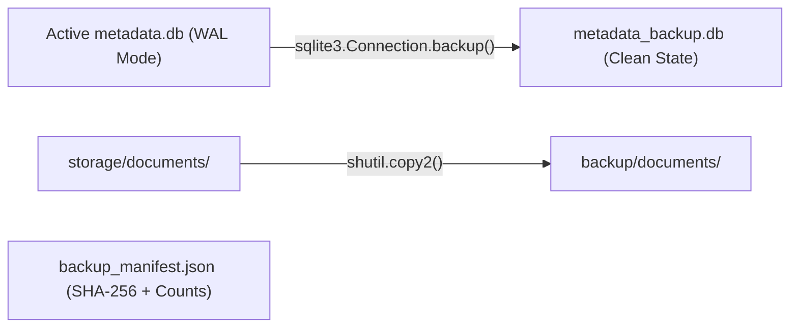

# Phase 7 — Backup & Disaster Recovery

## 1. Hot Backup Architecture
Because SQLite operates with Write-Ahead Logging (`WAL`), simply copying `metadata.db` while writers are active can lead to corrupted backups or incomplete transactions.

The platform provides `scripts/backup_restore.py`, utilizing Python's official `sqlite3.Connection.backup` API:



## 2. Manifest Schema (`backup_manifest.json`)
```json
{
  "manifest_version": "1.0",
  "timestamp_utc": "2026-10-15T01:56:00Z",
  "database_sha256": "...",
  "database_size_bytes": 1572864,
  "engine_metadata": {
    "model_name": "intfloat/multilingual-e5-small",
    "model_dimension": 384,
    "winnowing_k": 25,
    "winnowing_w": 16,
    "system_phase": "Phase 7"
  },
  "counts": {
    "documents": 459,
    "analyses": 155,
    "findings": 310,
    "reviewed_findings": 18,
    "collections": 6,
    "stored_files": 459
  }
}
```

## 3. Verification Command
```powershell
python scripts/backup_restore.py --test
```
Executes a round-trip backup and restore into an isolated temporary directory, verifying database integrity (`PRAGMA integrity_check`) and row counts.
