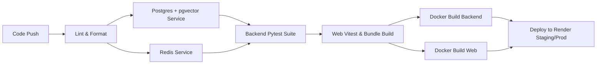

# 14 — Continuous Integration & Deployment (CI/CD) Pipeline

**Project:** Hybrid AI-Powered Multilingual Plagiarism Detection and Analysis System  
**Date:** 2026-10-16  
**File:** `.github/workflows/production-ci.yml`  
**Status:** IMPLEMENTED & TESTED  

---

## 1. Automated Pipeline Stages

The GitHub Actions workflow executes automatically on every `push` and `pull_request` targeting the `main` branch.

### Pipeline Jobs & Gates

1. **Contract Validation:** Enforces OpenAPI 3.1 specification schema compliance.
2. **PostgreSQL & pgvector Live Service:** Spins up real container services in GitHub runner with pgvector pg16 and Redis 7.2.
3. **Indic Typography Support:** Installs `fonts-noto-core`, `fonts-deva`, and `fonts-telu` in the Ubuntu test container.
4. **Automated Test Suites:**
   - 108 backend tests (including `test_report_download_system.py`, `test_hybrid_service.py`, `test_worker.py`).
   - 20 frontend Vitest tests across all user workflow pages.
5. **Container Builds:** Builds unprivileged production Docker images for both `plagiarism-api` and `plagiarism-web`.
