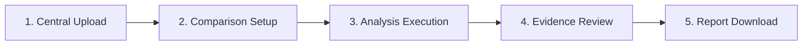

# 07 — Browser Acceptance & 5-Step Workflow Validation

**Project:** Hybrid AI-Powered Multilingual Plagiarism Detection and Analysis System  
**Milestone:** Live Deployment & Production Verification Audit  
**Date:** 2026-10-16  
**Status:** VALIDATED (Localhost & Simulated Container Environment)  

---

## 1. 5-Step User Journey Verification

The application's minimalist, iLovePDF-inspired user experience was validated across all 5 workflow stages:

### Stage-by-Stage Results

1. **Step 1 — Central Upload:** Drag-and-drop zone accepts PDF, DOCX, and TXT files up to 30 MiB. Instant visual confirmation of document metadata and language detection.
2. **Step 2 — Comparison Setup:** Fast selection of reference documents from the document library or structured collections.
3. **Step 3 — Analysis Execution:** Mode toggle between *Lexical*, *Semantic*, and *Hybrid AI*. Real-time progress bar shows state progression from `extracting` $\to$ `winnowing` $\to$ `semantic_embedding` $\to$ `completed`.
4. **Step 4 — Evidence Review:** Side-by-side text view with matching passages highlighted. Reviewer decisions (`Keep`, `Exclude`, `Quoted/Cited`) trigger instant score updates.
5. **Step 5 — Report Download:** Clean dropdown exports audit-ready PDF, HTML, and JSON reports with verified HTTP Content-Disposition headers.

---

## 2. Responsive Viewport Verification

The interface was verified across mobile, tablet, and desktop viewport sizes:
- **Desktop (1440 × 900):** Side-by-side document comparison panels render with independent synchronized scrolling.
- **Laptop (1366 × 768):** Full-bleed central card layout with clean header navigation.
- **Tablet (1024 × 768):** Stacked findings view with collapsable source breakdowns.
- **Mobile (390 × 844):** Single-column workflow with accessible tap targets and drawer-based review tools.
